# RepeatViewer Operations Manual

**Illustrated, task-oriented guide**

This manual shows **how to operate** RepeatViewer day to day: where to click,
what you should see, and how Preview / MSA Overview tools work together.

For parameter tables, output file names, and tool reference, use the companion
[User Manual](MANUAL.md).

---

## Contents

1. [What this guide is](#1-what-this-guide-is)
2. [Launch and the workspace](#2-launch-and-the-workspace)
3. [Open a folder and inspect a file](#3-open-a-folder-and-inspect-a-file)
4. [Single-sequence Overview](#4-single-sequence-overview)
5. [MSA Overview (detailed)](#5-msa-overview-detailed)
6. [Dotplot and image preview](#6-dotplot-and-image-preview)
7. [Duplicate Preview window](#7-duplicate-preview-window)
8. [Core curation loop](#8-core-curation-loop)
9. [Databases and settings](#9-databases-and-settings)
10. [Keyboard shortcuts and tips](#10-keyboard-shortcuts-and-tips)

---

## 1. What this guide is

| Document | Role |
|----------|------|
| **This Operations Manual** | Screenshots + step-by-step operation |
| [MANUAL.md](MANUAL.md) | Full reference (parameters, outputs, troubleshooting) |

Images live in [`docs/images/`](images/). Paths below are relative to this file.

To regenerate screenshots from a live Qt session (synthetic demo MSA + real
dialogs), run:

```bash
QT_QPA_PLATFORM=offscreen python scripts/capture_ops_screenshots.py
```

---

## 2. Launch and the workspace

### Goal

Start RepeatViewer and recognize the main panels.

### Steps

1. Activate your environment and launch:
   ```bash
   conda activate repeatviewer
   repeatviewer
   ```
   Or from the repo root: `python RepeatViewer.py`.
2. On first use, add a project folder (see §3) so Folders and Files fill in.

### Workspace anatomy

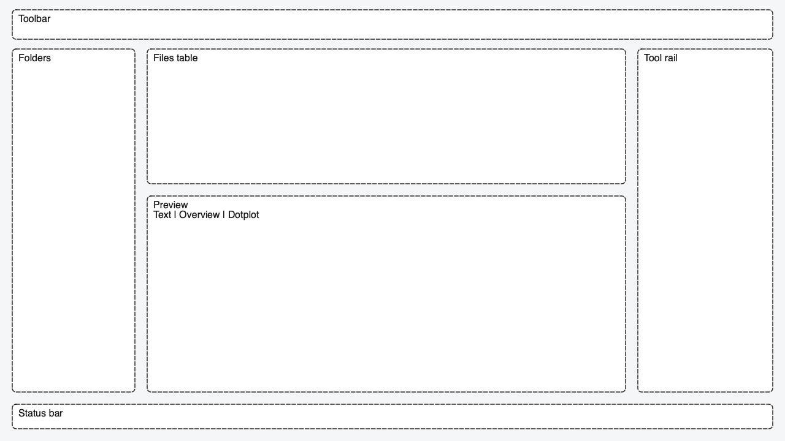

*Figure 1. Main window regions (schematic).*

| Region | What it does |
|--------|----------------|
| **Folders** | Project directories you have added |
| **Files** | Sortable table of files in the selected folder |
| **Preview** | Text / Overview / Dotplot (and related) views of the current file |
| **Toolbar** | Analysis tools (BLAST, Align, MSA Clean, …) |
| **Tool rail** | Context controls for the active Preview (tracks, colors, find, …) |
| **Status bar** | Job progress and short messages |

### What you should see

- Empty Folders/Files until you add a directory.
- Preview stays blank until you select a FASTA (or open an image/PDF result).

### Common mistakes

- Expecting tools to run with **no file selected** — select one or more rows in Files first.
- Looking for MSA Lens on a single unaligned FASTA — Lens appears on **aligned** MSA Overview only.

---

## 3. Open a folder and inspect a file

### Goal

Browse candidates and open one in Preview.

### Steps

1. **File → Add Folder…** (or the Folders panel add control) and choose a directory of TE FASTA files.
2. Click the folder in **Folders**.
3. In **Files**, click a `.fa` / `.fasta` row.
4. In **Preview**, use the tabs:
   - **Text** — editable sequence text
   - **Overview** — graphical map / MSA
   - **Dotplot (Self)** — when available for that file type

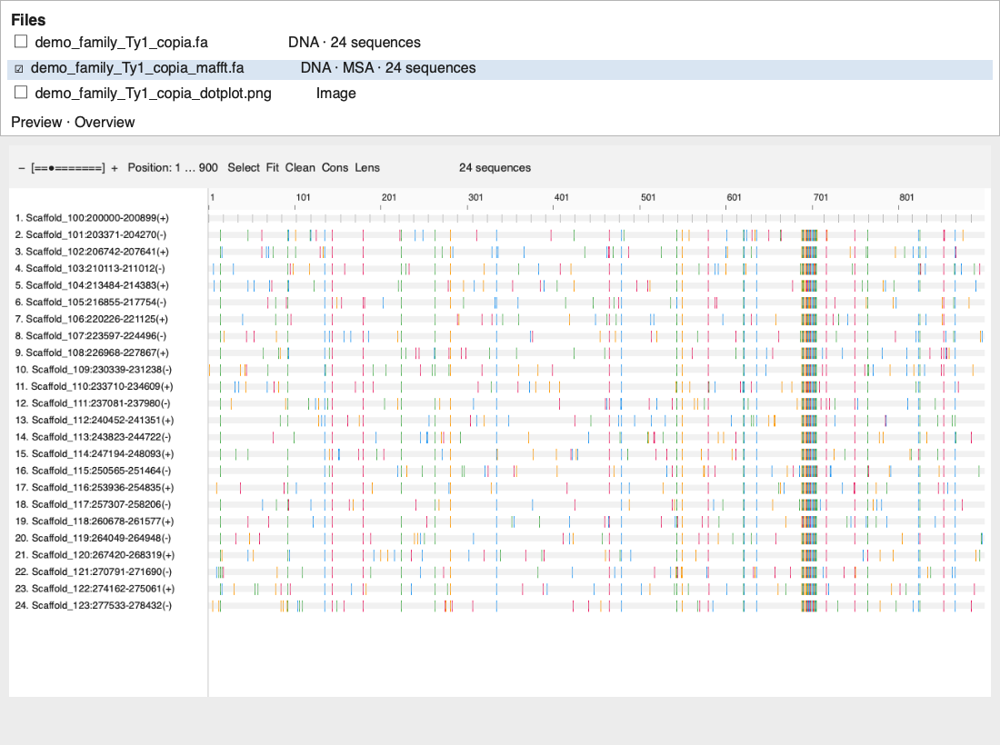

*Figure 2. Files table (top) and Preview → Overview (bottom) for a multi-sequence FASTA.*

### What you should see

- Selected file highlighted in Files.
- Preview title shows the file name; Overview draws bars or an MSA matrix.
- Sequence count appears on the Overview toolbar when multiple sequences are loaded (e.g. “39 sequences”).

### Common mistakes

- Double-clicking an image result when you meant the FASTA — Preview then shows the PNG/PDF, not the alignment. Select the `.fa` again for Overview editing.

---

## 4. Single-sequence Overview

### Goal

Inspect one consensus (or one record) with annotation tracks.

### Steps

1. Select a single-sequence FASTA in Files.
2. Open **Preview → Overview**.
3. Use **− / +** or the zoom slider to change horizontal scale.
4. Click **Fit** to fit the sequence to the visible track width.
5. Drag on the scale or tracks to select a **column range**; **Position** spins update to match.
6. Click **Select** to zoom the view to the current Position / selection range.

### What you should see

- A horizontal bar for the sequence length, with annotation arrows when features exist (ORF, Pfam, …).
- A pale blue band and dashed guides for the selected columns.

### Common mistakes

- Confusing **Fit** (whole sequence in view) with **Select** (zoom to the current range).

---

## 5. MSA Overview (detailed)

Aligned FASTA files open as a **multiple sequence alignment** in Overview: numbered
sequence names on the left, residue tracks in the center, and display controls on
the right.

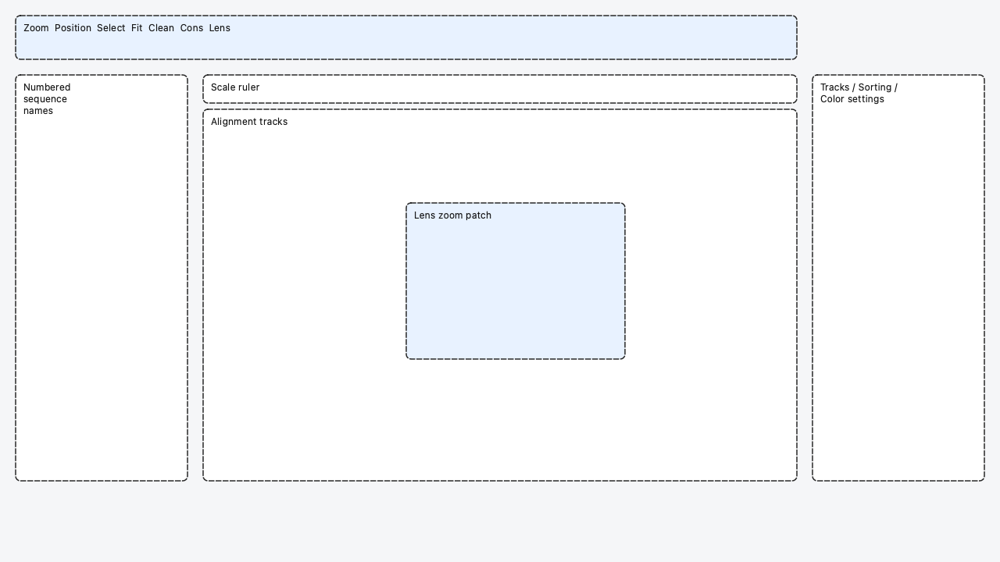

*Figure 3. MSA Overview regions (schematic).*

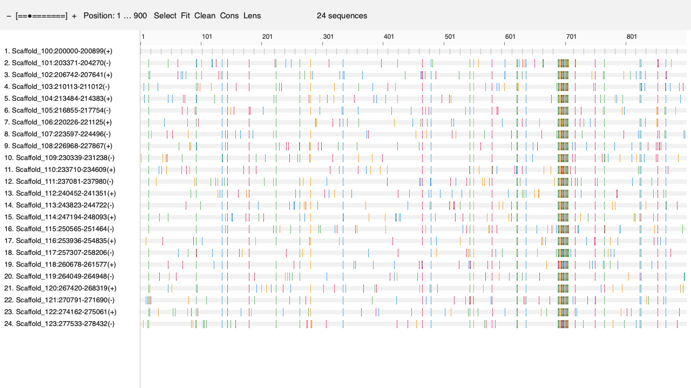

*Figure 4. Live MSA Overview: zoomed-out alignment, Position spins, and Lens toggled on.*

### 5.1 Numbered sequence names

Each row in the name column is labeled **`N. sequence_id`** (1-based, current
display order). Numbers match the row indices shown in the Lens patch, so you
can cross-reference without reading long scaffold coordinates.

### 5.2 Zoom, Position, Fit, Select

| Control | Action |
|---------|--------|
| **− / +** and slider | Change pixels-per-base (zoom) |
| **Position** spins | Inclusive column range (1-based) |
| **Fit** | Fit the full alignment width into the track viewport |
| **Select** | Zoom so the current Position / column selection fills the view |

**Shift + mouse wheel** over the tracks also zooms, anchored under the pointer.

### 5.3 Sequence row selection

**Goal:** highlight one or more sequences (names **and** MSA rows).

1. Click a name to select that row.
2. Drag vertically in the **name column** to select a contiguous block of rows.
3. Selected names use a blue wash; the MSA rows show matching selection chrome.

Row selection and **regional** matrix selection are different modes; starting a
new regional drag clears a prior matrix box. Column selection **keeps** prior
row highlighting (see below).

### 5.4 Column selection

**Goal:** mark a span of alignment columns across all sequences (or keep rows
visible underneath).

1. Drag horizontally on the **bottom scale ruler**, or set **Position** spins.
2. While dragging you see **vertical dashed guides** (live outline only — stays smooth).
3. On release, the MSA shows a **blue wash** between the guides plus the dashed edges.
4. The scale ruler also highlights the same span.

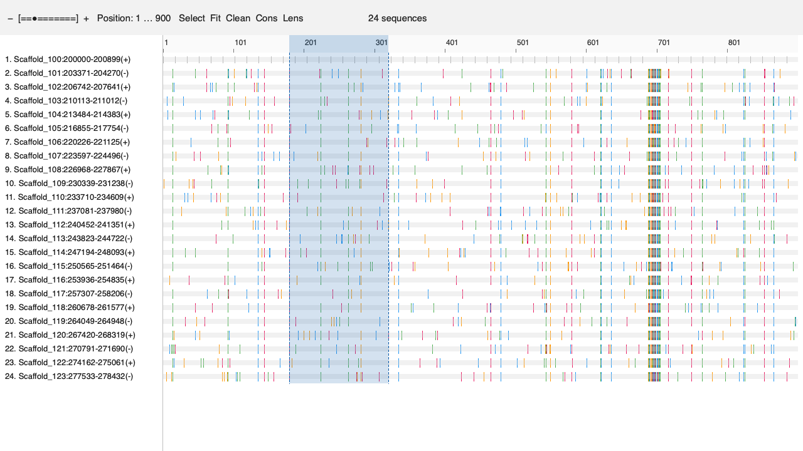

*Figure 5. Column selection: scale highlight and vertical guides through the MSA.*

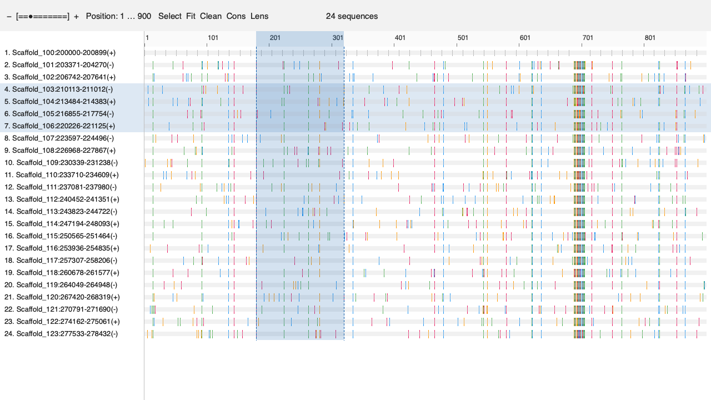

*Figure 6. A sequence row stays highlighted in the name column while a column
band (Position 635–856) washes the MSA.*

**Row then column:** select sequences first, then drag a column range. Both
remain visible — names, row wash on the tracks, and the column band.

### 5.5 Regional (matrix) selection

**Goal:** select a rectangle of columns × rows on the MSA (AliView-style).

1. Drag a box **on the residue tracks** (not only the scale).
2. Live outline follows the pointer (pixel-follow at overview zoom; cell-snapped
   when letters are visible).
3. On release, the box is committed; Position and name highlights follow the
   covered columns and rows.

Regional drag is the smoothest selection path; row/column chrome use the same
cheap edge-update strategy so they stay responsive on large MSAs.

### 5.6 Lens

**Goal:** inspect residues under the pointer without zooming the whole MSA.

1. Click **Lens** on the Overview toolbar (MSA only). The button stays checked
   while the mode is on.
2. Move the mouse over the alignment. A **zoom patch** appears near the pointer:
   column ruler, row numbers, and colored nucleotides (no full sequence names
   in the patch — use the numbered name column instead).
3. Move slowly: the focus advances in **small steps** (~10 px per column,
   ~8 px per row) so a zoomed-out overview does not skip thousands of columns.
4. **Double-click** while Lens is on to **zoom the main view** to the patch
   window and select that region.
5. Press **Esc** (or click Lens again) to leave Lens mode.

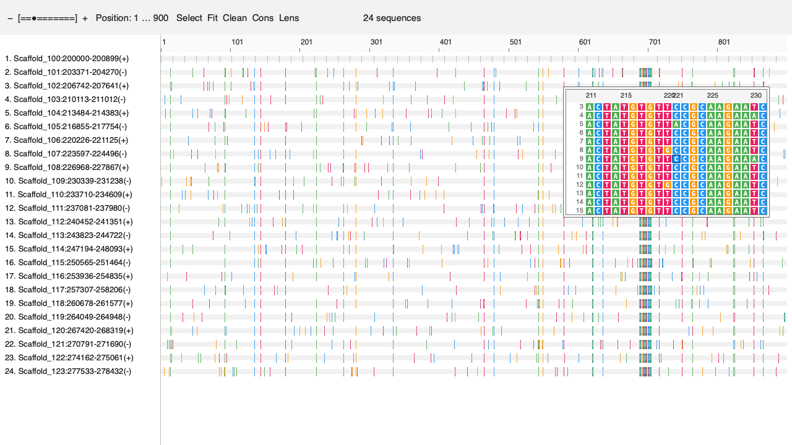

*Figure 7. Lens on: overview stays zoomed out; floating patch shows local residues.*

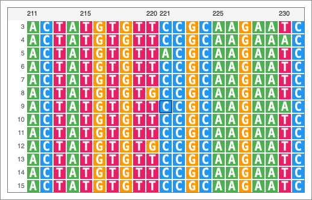

*Figure 8. Lens contents: column numbers on top, row indices on the left, focus
cell outlined.*

#### What you should see

- Normal arrow cursor (not a custom magnifier icon).
- Patch stays visible while the pointer is over the tracks; it hides when you
  leave the canvas and returns when you re-enter.
- Positions are readable from the patch ruler — there is no separate title like
  “Columns … · focus …”.

#### Common mistakes

- Expecting Lens on an unaligned single sequence — enable it only for MSA Overview.
- Moving very fast on a fit-zoom MSA and thinking Lens is broken — slow down; steps are intentional.
- Looking for the patch off-screen — it is clipped inside the Preview viewport.

### 5.7 Clean and Cons

| Button | Action |
|--------|--------|
| **Clean** | Opens **MSA Clean** parameters for the alignment in this Overview |
| **Cons** | Opens **Consensus** parameters |

Full options: [MANUAL.md § MSA Clean / Consensus](MANUAL.md#msa-clean).

### 5.8 Right rail (tracks, sorting, colors)

Typical MSA display controls (rail on the right of Overview):

- **Show annotations** — feature tracks under residue bands
- **Sorting** — Original / Name / Selected columns
- **MSA color scheme** — e.g. Color all, Color divergent, Color conserved, No color
- Nucleotide vs protein coloring presets

Change these while viewing; they do not rewrite the FASTA until you run a tool
that writes a new file.

---

## 6. Dotplot and image preview

### Goal

Inspect self-similarity or exported plot images.

### Steps

1. Select a FASTA that has a Dotplot tab, or select a generated `.dotplot.png` /
   `.dotplot.pdf` in Files.
2. For the interactive tab: **Preview → Dotplot (Self)**.
3. Use zoom controls / Actions as provided on that view.
4. To export from Dotplot views that support it: use **Export** (Type PDF/PNG/SVG,
   DPI, destination file) — see the on-dialog fields.

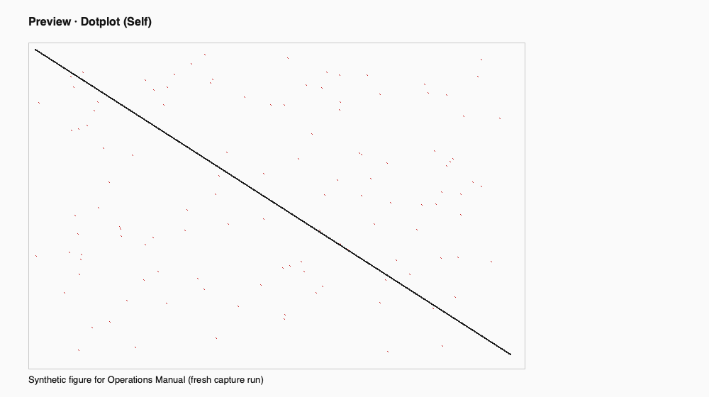

*Figure 9. Preview showing an interactive / embedded dotplot with metadata.*

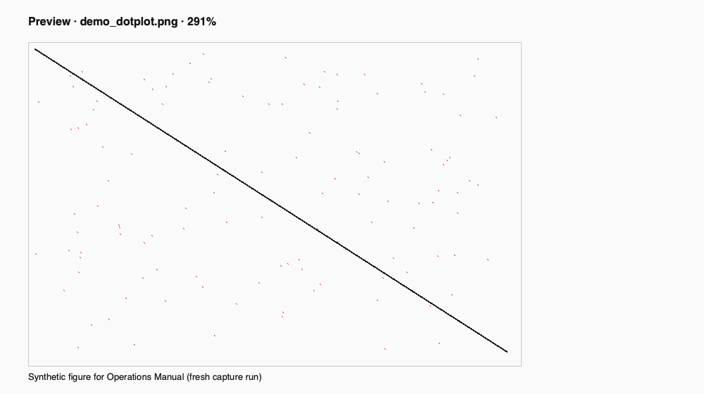

*Figure 10. Selecting a `.dotplot.png` in Files opens it in the image Preview.*

### What you should see

- Diagonal self-match signal for a self-dotplot.
- Related FASTA may stay soft-highlighted when a plot output is selected.

### Common mistakes

- Editing the PNG instead of the FASTA — plots are outputs; re-run Flexidot /
  Visualization if you need an updated figure.

---

## 7. Duplicate Preview window

### Goal

Keep an Overview open beside Folders/Files while you click other files.

### Steps

1. From Preview Actions (or the duplicate control your build exposes), open a
   **duplicate Preview** window.
2. Leave it non-modal: you can click Folders/Files while it stays open.
3. The duplicate Overview focuses on viewing — it does **not** carry the main
   window’s Actions chrome.

### What you should see

- A floating window parented to RepeatViewer (not stuck above Safari/Finder).
- Raising RepeatViewer brings the duplicate forward with the app.

### Common mistakes

- Expecting OS-wide always-on-top behavior — RepeatViewer deliberately avoids
  global always-on-top; use parenting + raise instead.

---

## 8. Core curation loop

### Goal

One pass: find copies → align → clean → extend → rebuild consensus.

Detailed parameters: [MANUAL.md § Quick start](MANUAL.md#3-quick-start-your-first-curation-pass).

### Typical order

1. Select a candidate FASTA in Files.
2. **BLAST** against your reference genome (Manage Database first if needed).
3. **Align** hits (MAFFT/MUSCLE) to build an MSA.
4. Open the MSA in **Overview**; use Lens / selections to inspect problem regions.
5. **MSA Clean** (Clean button or toolbar) to drop gappy columns / bad rows.
6. **MSA Extend** if boundaries are truncated.
7. **Consensus** (Cons) to rebuild the TE consensus.
8. Re-check Overview / Dotplot / TE-Aid.

### Monitoring jobs

Long tools open a progress / log window. You can leave it open and continue
browsing; **Close** when finished.

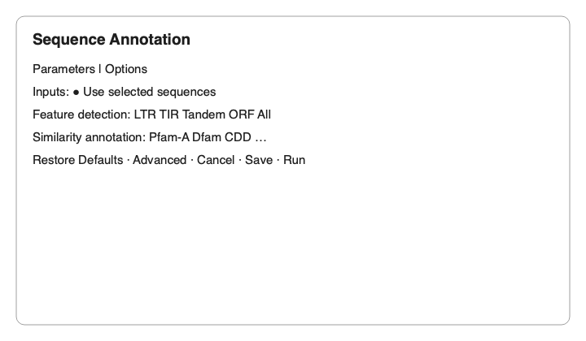

*Figure 11. Example tool dialog: Inputs, feature detection, similarity databases.*

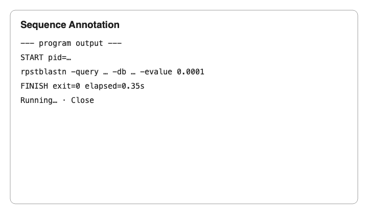

*Figure 12. Live job log with commands and Running… status.*

### What you should see

- New outputs appear next to the input in Files (often green highlight).
- Failed steps show a clear dialog; check External tools if binaries are wrong.

---

## 9. Databases and settings

### Manage Database

1. **File → Manage Database…**
2. Use tabs (**BLAST database**, **HMM database**, **Others**).
3. Search by name/path; enable databases for the Annotation panel as needed.

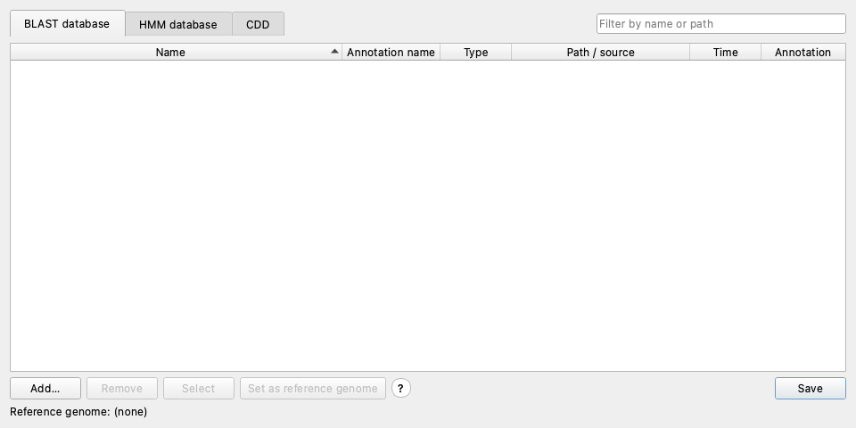

*Figure 13. Manage Database listing HMM resources.*

### Add a database

1. From Manage Database, add a new entry (or equivalent Add control).
2. Choose **Type** (e.g. FASTA DNA), optional **Name** / **Short name**, and **Path**
   (Browse, or click a file in Files).
3. Optionally **Display in the annotation control panel** and/or **Set as reference genome**.
4. **OK**.

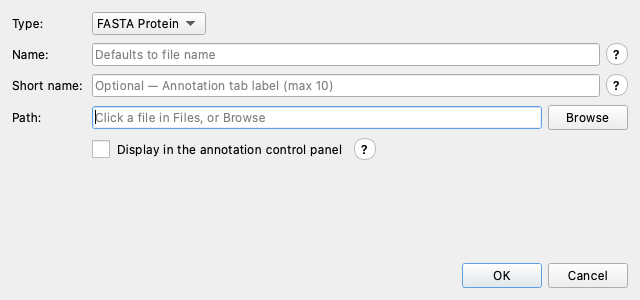

*Figure 14. Add database dialog.*

### External tools

**File → Setting → External tools** — point at a conda environment that has
RepeatMasker, FastGA, IQ-TREE, etc. Use **Check** to verify resolution.

Full list: [MANUAL.md § External tools](MANUAL.md#external-tools).

---

## 10. Keyboard shortcuts and tips

| Action | How |
|--------|-----|
| Exit Lens | **Esc** (or toggle Lens off) |
| Zoom tracks | **Shift + mouse wheel** over MSA / Overview |
| Select all sequences | Standard Select All in the name column focus |
| Delete selection | Delete / Backspace when names or features are focused |

### Tips

- **Wheel over spin boxes / combos does not change values** — scrolling the
  panel scrolls the panel only (NoWheel widgets).
- **Non-modal tool windows** stay usable with Folders/Files; they are parented
  to RepeatViewer and are **not** OS global always-on-top.
- Prefer **regional** rubber for bulk MSA edits; use **column** + **row** when
  you need full-height columns or named sequence sets.
- After Lens **double-click zoom**, use **Fit** to return to the full alignment.

### If something looks wrong

| Symptom | Try |
|---------|-----|
| No Lens button | File is not an MSA / Overview not in MSA mode |
| Lens patch missing | Move onto the tracks; leave and re-enter the canvas; ensure Lens is checked |
| Column guides but no wash | Finish the drag (wash is on commit); confirm you are not still in live preview |
| Row highlight gone after columns | Update to a build that keeps row wash under column select; re-select rows if needed |
| Tool binary errors | Manage Database / External tools; see job log |

---

## Image index

| File | Description |
|------|-------------|
| `images/schematic-workspace.png` | Main window regions |
| `images/schematic-msa-overview.png` | MSA Overview regions |
| `images/workspace-files-msa.png` | Files + MSA Overview |
| `images/msa-overview-full.png` | MSA with Lens toggled |
| `images/msa-overview-lens.png` | Lens patch over overview |
| `images/msa-lens-closeup.png` | Lens nucleotides close-up |
| `images/msa-column-selection.png` | Column guides |
| `images/msa-row-and-column.png` | Row + column together |
| `images/msa-overview-toolbar.png` | Toolbar strip crop |
| `images/preview-dotplot-tab.png` | Dotplot in Preview |
| `images/preview-dotplot-png.png` | Dotplot PNG from Files |
| `images/dialog-manage-database.png` | Manage Database |
| `images/dialog-add-database.png` | Add database |
| `images/dialog-sequence-annotation.png` | Annotation parameters |
| `images/job-log-annotation.png` | Running job log |

---

*RepeatViewer Operations Manual — companion to [MANUAL.md](MANUAL.md).*
