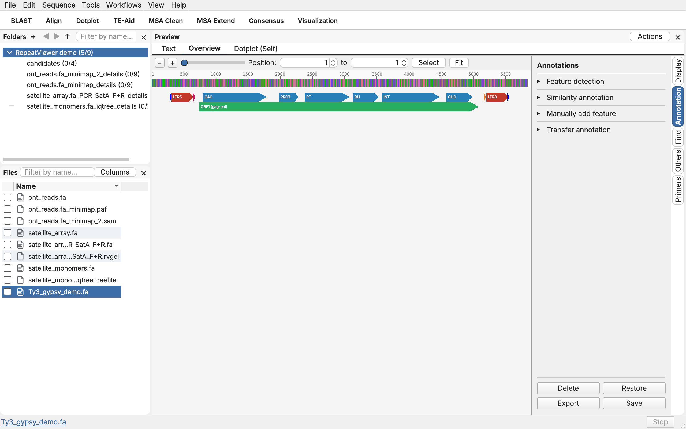

# Introduction

RepeatViewer is a free desktop application for working with repetitive DNA:
transposable elements (TEs), satellite DNA and other repeats. It puts a file
browser, a sequence viewer and a set of analysis tools in one window, so that
the everyday loop of looking at a sequence, running a tool, checking the
result and running the next tool happens in one place, without writing
command lines by hand.

## What RepeatViewer is for

Automated repeat pipelines produce candidate consensus sequences that are
rarely ready to publish. Boundaries are wrong, terminal repeats are cut short,
alignments contain fragments and unrelated copies, and classifications need
checking. This last step is manual and repetitive: many small tool runs on the
same files.

RepeatViewer is built for that work. You point it at a folder, click a file to
see it, run a tool from the toolbar, and the result appears in the same folder,
highlighted, ready to be the input of the next step. Next to TE curation it
covers the work around repeats in a plant genomics lab:

- **Sequences and annotations**: view, annotate, edit and export features
  (LTRs, TIRs, TSDs, domains, ORFs, tandem repeats), find motifs, transfer
  annotations between sequences.
- **Search and alignment**: BLAST (local and NCBI), HMMER, MAFFT, MUSCLE and
  FastGA, with an alignment viewer and alignment cleaning.
- **Curation**: MSA Extend, MSA Clean, Consensus, boundary prediction, TSD
  search, TE-Aid reports.
- **Mapping**: place reads or copies on a reference with minimap2 or HISAT2
  and see where they differ.
- **Trees**: build trees with IQ-TREE, FastME or FastTree and explore them in an
  interactive tree viewer.
- **Repeat quantification and plots**: copy numbers of satellites and TE
  families in genomes, density, divergence and abundance plots, dotplots.
- **Primers and probes**: design and test PCR primers and FISH probes, run
  in-silico PCR and look at the expected gel.
- **Automation**: workflows, plugins and command wrappers.

## What RepeatViewer is not

RepeatViewer does not discover TEs in a raw genome and does not build a TE
library from scratch. That is the job of tools such as
[TEtrimmer](https://github.com/qjiangzhao/TEtrimmer), of which RepeatViewer
started as the interactive companion. RepeatViewer works equally well on any
folder of sequences and does not need TEtrimmer.

## Names

The application is called **RepeatViewer**. The Python package and the command
you type in a terminal are **`repeatviewer`**. Older material may call the
project TEviewer.

## Authors

This manual was written by Abdullah Yusuf, Nusrat Sultana, Jiangzhao Qian and
Tony Heitkam (Molecular Botany, RWTH Aachen University).

## How to read this manual

The chapters follow the kind of work you do, not the order of the toolbar:

| Chapter | Covers |
|---------|--------|
| [Installation](02-installation.md) | Installing RepeatViewer and the optional external programs |
| [Quick start](03-quick-start.md) | One complete curation pass, step by step |
| [The interface](04-interface.md) | Panels, toolbar, Edit menu, Find, keyboard shortcuts, how every tool behaves |
| [Sequences](05-sequences.md) | Viewing sequences, the Overview, sequence operations, NCBI downloads |
| [Annotations](06-annotations.md) | Feature detection, editing, transfer, export, Sequence Annotation, TSD search |
| [Search](07-search.md) | Manage Database, BLAST, Online BLAST, HMMER |
| [Alignments](08-alignments.md) | Align, the alignment viewer, MSA Clean, MSA Extend, Consensus |
| [Mapping](09-mapping.md) | Mapping reads or copies to a reference and reading the result |
| [Trees](10-trees.md) | Building trees and the tree viewer |
| [Repeat analysis](11-repeat-analysis.md) | TE-Aid, dotplots, Repeat Quantify, genome plots |
| [Primers and PCR](12-primers.md) | Primer design, primers on a sequence, in-silico PCR, gels, the primer database |
| [Automation](13-automation.md) | Workflows, plugins, command wrappers, command line |
| [Settings](14-settings.md) | Preferences and the toolbar |
| [Reference](15-reference.md) | Output files, troubleshooting, citation |

Conventions:

- Menu paths are written in bold with arrows: **Tools → Align → MAFFT**.
- Keyboard shortcuts are given for macOS first, then Windows and Linux:
  **⌘F** / **Ctrl+F**.
- File names in output tables use `<name>` for the full name of the input file,
  extension included.
- A round **?** button next to an option in any RepeatViewer window opens a
  short help text for that option. This manual explains how the parts fit
  together; the **?** texts give the detail for each setting.

The screenshots were taken from synthetic demo data (a made-up Ty3/gypsy
element, satellite monomers and simulated nanopore reads), so the numbers in
them have no biological meaning.
