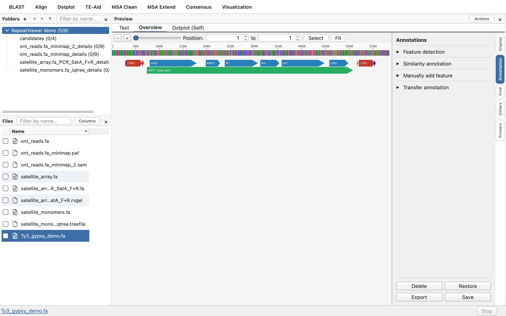
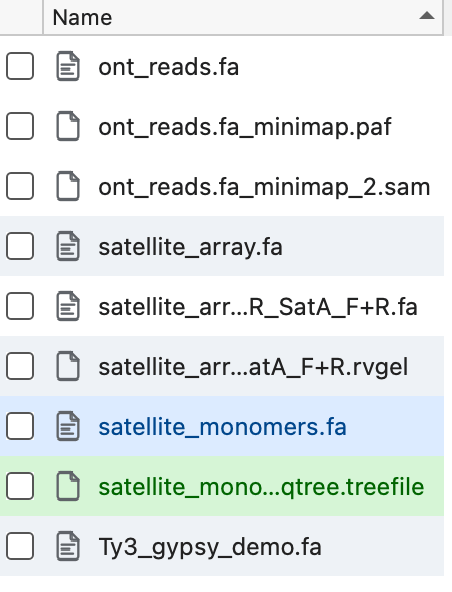
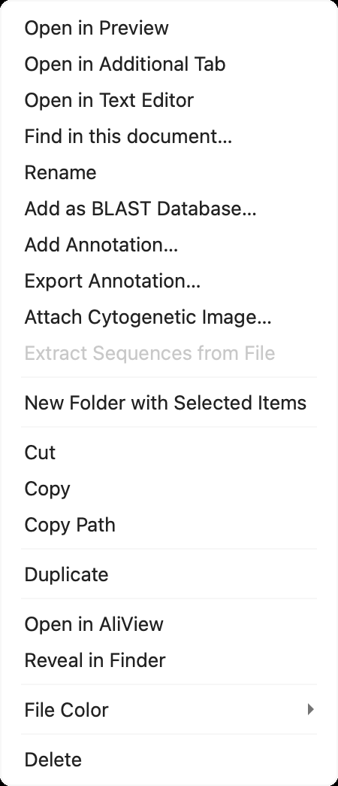
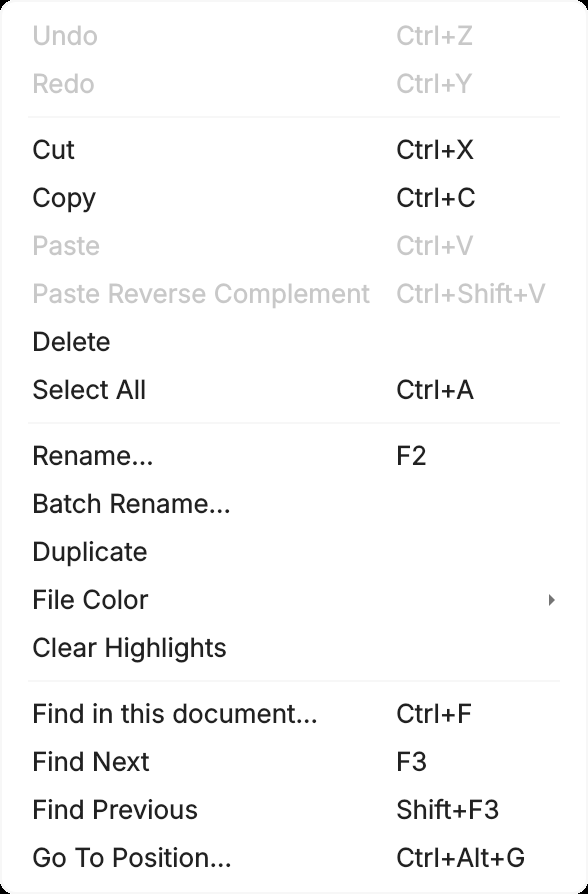
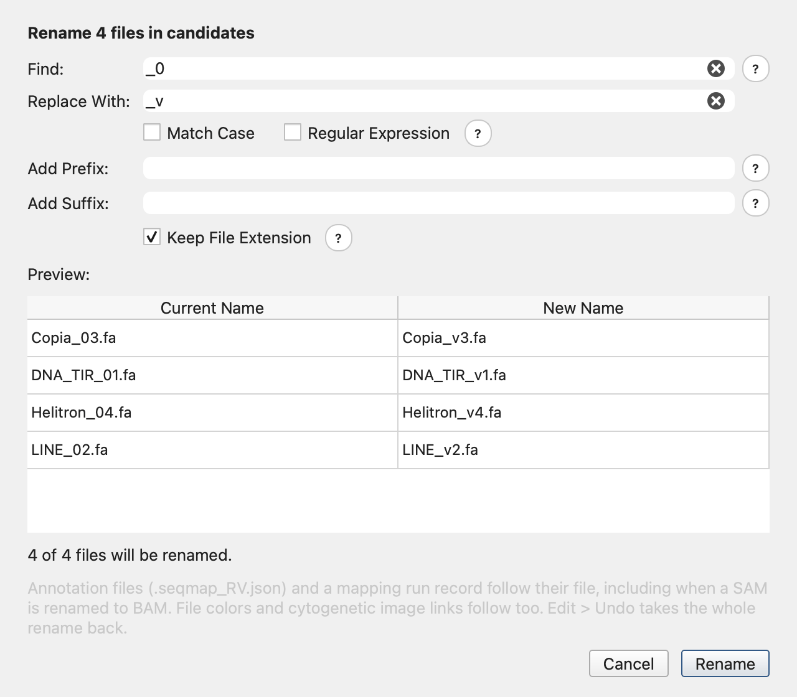
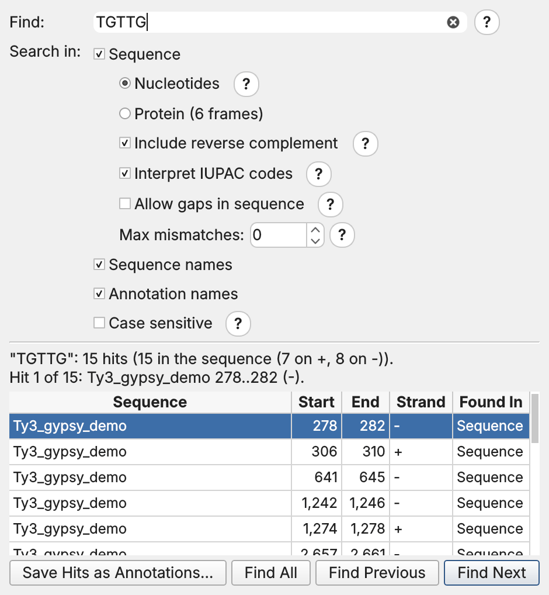
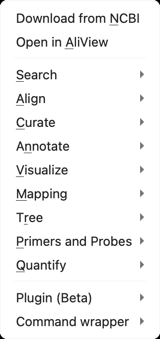

# The interface

The main window has three panels, a toolbar, a menu bar and a status bar. By
default the Folders and Files panels sit on the left and the Preview panel on
the right.

## Folders panel

Shows the folders you added (top-level folders) and their subfolders.

| Control | What it does |
|---------|--------------|
| **+** | Add a folder as a new top-level folder |
| **◀ ▶** | Back and forward through folders you visited |
| **↑** | Go to the parent folder |
| **Filter by name…** | Show only folders whose name contains the text |
| **×** | Hide the panel (**View → Folders** shows it again) |

Each folder shows two numbers, for example `(3/6)`: files that pass the Files
filter, out of all files in the folder.

Right-click a folder to add or create folders, rename it, paste files into it,
give it a colour, or remove a top-level folder from the list. Removing only
hides it from the panel; nothing is deleted on disk.
**File → Restore deleted files** brings removed top-level folders back, and
**⌘Z** undoes the removal right away.

## Files panel

Lists the files of the selected folder. Click a file to open it in Preview.
Select several files with **⌘**-click or **Shift**-click, or tick their boxes,
for tools that take more than one input.

- **Filter by name…** shows only matching files.
- **Columns** chooses extra columns: length, number of sequences, GC %, type,
  description, modified date, size, colour and cytogenetic images. By default
  only the name is shown; the default set is chosen in
  **File → Setting → General → Files columns**.
- Related files sit together: a FASTA and the outputs made from it are grouped
  by name, so `CroSat2.fa`, `CroSat2.fa_bn.txt` and `CroSat2.fa_bn.txt.fa`
  appear one after another.
- Drag a GFF, GFF3, GTF or BED file onto a FASTA row to attach it as an
  annotation (see [Annotations](06-annotations.md)).
- Files can be dragged to other folders in the Folders panel, or to Finder and
  other applications.

Right-click a file for the actions that fit it:

| Item | What it does |
|------|--------------|
| Open in Preview / Open in Additional Tab | Show the file in the current Preview tab, or in a new tab next to it |
| Open in Text Editor | Edit the file as plain text in Preview |
| Find in this document… | Open Find for this file (see [Find](#find-and-go-to)) |
| Rename | Rename the file (**F2**) |
| Add as BLAST Database… | Index this FASTA for BLAST (see [Manage Database](07-search.md#manage-database)) |
| Add Annotation… / Export Annotation… | Attach a GFF/BED file, or write the annotations to GFF3, GTF, BED or a figure |
| Attach Cytogenetic Image… | Link a microscope image (FISH, karyotype) to this sequence |
| Extract Sequences from File | Pick records from a multi-FASTA (see [Sequences](05-sequences.md)) |
| Separate Sequence into N Files / Folders | Split a multi-FASTA, one record per file or folder |
| Combine N Sequences to One File | Merge the selected FASTA files |
| New Folder with Selected Items | Move the selection into a new folder |
| Cut, Copy, Copy Path, Paste, Duplicate, Delete | File operations; all can be undone |
| Open in AliView | Open an alignment in AliView |
| Show in File Manager / Reveal in Finder | Show the file in Finder or Explorer |
| File Color | Mark the file with a colour |

## Preview panel

Shows the selected file. What you see depends on the file type:

| File | View |
|------|------|
| FASTA, one sequence | **Text**, **Overview** (annotated map) and **Dotplot (Self)** sub-tabs |
| FASTA, several sequences | Overview of all records, one row each |
| Aligned FASTA | Alignment viewer (see [Alignments](08-alignments.md#the-alignment-viewer)) |
| Tree (`.treefile`, `.nwk`, `.newick`) | Tree viewer (see [Trees](10-trees.md)) |
| SAM, BAM, CRAM, GFF, GTF, BED | Genome browser (see [Mapping](09-mapping.md)) |
| PAF, `.1aln` | Alignment dotplot |
| `.rvgel` | In-silico gel (see [Primers and PCR](12-primers.md)) |
| HTML reports | TE-Aid, tree and mapping reports, plots, shown live |
| PDF, images, text, tables | Shown as they are |

The **Actions** button in the Preview title bar has:

- **Reset scale**: back to the default zoom.
- **Edit text** / **Save text**: edit a text or FASTA file in place. If you
  leave a file with unsaved typing, RepeatViewer asks whether to save it.
- **Duplicate window**: a copy of the current Preview in its own window.
- **Split window**: two Preview panes side by side, to compare two files.

Right-click a Preview tab to open it in the right or left half of a split.
**Open in Additional Tab** (right-click a file) keeps the current tab and adds
another one, which is the quickest way to compare a before and an after.

HTML reports have a zoom box and **Open in browser** in the title bar.

## Toolbar

The tools you use most, as buttons. The default set is BLAST, Align, Dotplot,
TE-Aid, MSA Clean, MSA Extend, Consensus and Visualization. Choose which
buttons appear, and in which order, in **File → Setting → Toolbar**.

Most buttons do two things:

- **Click**: run the tool on the selected files with your saved settings, or
  open its window when it needs choices every time.
- **Right-click**: the other of the two. What right-click does is set on the
  **Options** tab of each tool's window ("Right-click action").

Buttons with a small arrow open a menu (for example Visualization).

## Status bar

The bottom line of the window shows the name of the last previewed file (click
it to show the file in Finder or Explorer), or the result of the last job.
While a tool runs it shows **Running <Tool>…**, a blue progress bar and a
**Stop** button. For files with many sequences the bar advances sequence by
sequence and says how many are done and how many are left.

## The Edit menu

The Edit menu acts on the panel you are working in: the Files panel, the
Folders panel, the tree viewer, or the text field that has the cursor.

**Undo and Redo** (**⌘Z**, **⇧⌘Z**) cover file actions: delete, paste, move,
overwrite, rename, Batch Rename, duplicate, and removing a folder from the
list. A copy that you changed after it was made is never deleted by Undo. In a
text being edited, Undo first undoes your typing.

**Cut, Copy, Paste** work on files in the Files and Folders panels, and on text
in text fields.

**Paste Reverse Complement** (**⇧⌘V**) pastes the reverse complement of the DNA
on the clipboard into a text field or a sequence being edited. IUPAC codes,
case, gaps and line width are kept; FASTA headers get " reverse_complement"
added. Protein on the clipboard is not pasted.

**Rename…** (**F2**) renames the selected file or folder.

**Batch Rename…** renames many files at once: find and replace (with **Match
Case** and **Regular Expression**, where `\1` refers to a group), add a prefix
or suffix, and keep the file extension (`.fa.gz` stays together). The table
shows every new name before anything changes; names that are taken, repeated
or invalid are shown in red and **Rename** stays off until all are fine.
Annotation files, mapping records, file colours and image links follow their
files. One Undo puts everything back.

**Duplicate** copies the selected files or folders. **File Color** marks files
with a colour. **Clear Highlights** removes the blue and green job highlights.

## Find and Go To

**Edit → Find in this document…** (**⌘F**) searches the file in Preview.

- **Sequence**: a motif in **Nucleotides**, or in **Protein (6 frames)** (the
  DNA is translated in all six frames).
- **Include reverse complement** searches both strands.
- **Interpret IUPAC codes**: R matches A or G, N matches anything, in the motif
  and in the sequence.
- **Allow gaps in sequence**: gaps in alignment rows are skipped, so a motif
  is found across them.
- **Max mismatches**: how many differences a hit may have.
- **Sequence names** and **Annotation names**: also match record names and
  feature names.

**Find All** lists every hit (up to 100,000). **Find Next** (**F3** or **⌘G**)
and **Find Previous** (**⇧F3**) move through them; the view jumps to each hit
and keeps your zoom when the letters are readable. **Save Hits as
Annotations…** adds the hits as features. Large files are searched in the
background with a progress bar and **Stop**. Closing Find removes the
highlights.

The same search is in the **Find** tab of the Overview side panel, for quick
searches without a separate window.

**Edit → Go To Position…** (**⌥⌘G**) jumps to a position or range:
`1200`, `1000-2000` or `scaffold_5:1000-2000`.

## Keyboard shortcuts

| macOS | Windows / Linux | Action |
|-------|-----------------|--------|
| ⇧⌘O | Ctrl+Shift+O | Add Folder |
| ⇧⌘N | Ctrl+Shift+N | New Folder |
| ⇧⌘G | Ctrl+Shift+G | Manage Database |
| ⌘, | Ctrl+, | Settings |
| ⌘Z | Ctrl+Z | Undo |
| ⇧⌘Z | Ctrl+Y or Ctrl+Shift+Z | Redo |
| ⌘X, ⌘C, ⌘V | Ctrl+X, Ctrl+C, Ctrl+V | Cut, Copy, Paste |
| ⇧⌘V | Ctrl+Shift+V | Paste Reverse Complement |
| ⌘A | Ctrl+A | Select All |
| F2 | F2 | Rename |
| ⌘F | Ctrl+F | Find (in the Files or Folders panel: focus its filter box) |
| F3 or ⌘G | F3 or Ctrl+G | Find Next |
| ⇧F3 | Shift+F3 | Find Previous |
| ⌥⌘G | Ctrl+Alt+G | Go To Position |
| F5 or ⌘R | F5 | Refresh the current folder |
| Delete or Backspace | Delete | Delete the selected files (asks first; can be undone) |
| ⌘Q | Ctrl+Q | Quit |

In the sequence, alignment and tree views:

| Input | Overview, alignment, tree, dotplot | Genome browser (mapping) |
|-------|------------------------------------|--------------------------|
| Scroll | Move through the view | Move through the view |
| Shift + scroll | Zoom around the mouse | Scroll up and down through the rows |
| ⌘ + scroll, or pinch | | Zoom around the mouse |
| − / + buttons, slider | Zoom | Zoom |
| Double-click empty space | Fit the whole sequence or tree | |

## How every tool behaves

The same rules hold for every tool. Knowing them saves reading each tool's
section closely.

**Outputs land next to their input.** A tool run on `/data/run2/CroSat2.fa`
writes into `/data/run2/`. The next tool in the curation loop takes the last
output as its input, so they belong together.

**Output names keep the full input name.** A suffix is added to the whole name,
extension included: `CroSat2.fa` → `CroSat2.fa_mafft.fa`. You can always tell
which file a result came from. Tools that make many files put only the main
result next to the input and the rest into a `<name>_details` folder.

**Nothing is overwritten.** A second run on the same input writes `_2`, `_3`,
and so on. When you name a file yourself and the name is taken, RepeatViewer
asks whether to **Overwrite**, **Cancel** or **Rename…**.

**Highlights show what happened.** During a run the input files are blue and
new files green. Afterwards the inputs are light blue, the new files green, and
the main result opens in Preview, selected in deep blue.

**Jobs run in the background.** You can keep browsing and previewing while a
tool runs. Several jobs can run at the same time, up to **Max. parallel jobs**
in **File → Setting → General → Performance**. **Stop** in the status bar
cancels.

**Selection drives the tools.** Tools act on the files selected in the Files
panel. In each tool window, **Inputs** offers **Use selected sequences** or
**Define inputs** (other files for this run only).

**Click a file to fill a field.** While a tool window is open, clicking a file in
the Files panel fills the path field you are working on, for example a
reference or a genome. **Browse** works too.

**Windows look the same.** Each tool window has the tabs of its programs plus an
**Options** tab (what right-click runs, whether to show the process window,
whether to use your own copy of the program). Buttons are always
**Restore Defaults** and **Advanced Settings ▸** on the left, **Cancel**,
**Save** and **Run** on the right. **Save** keeps the settings without running.
Settings are remembered between sessions.

**Every tool is in the Tools menu.** Tools with many settings have two items:
"… with default parameters" (run with the saved settings) and "Change …
parameters" (open the window).

