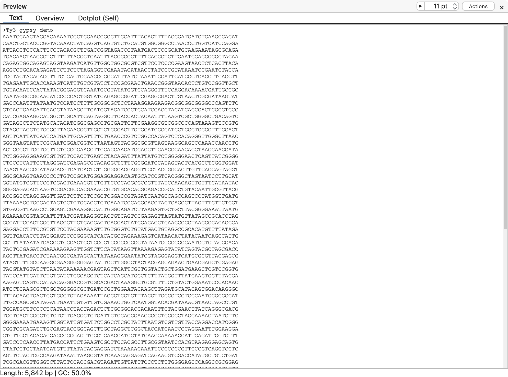
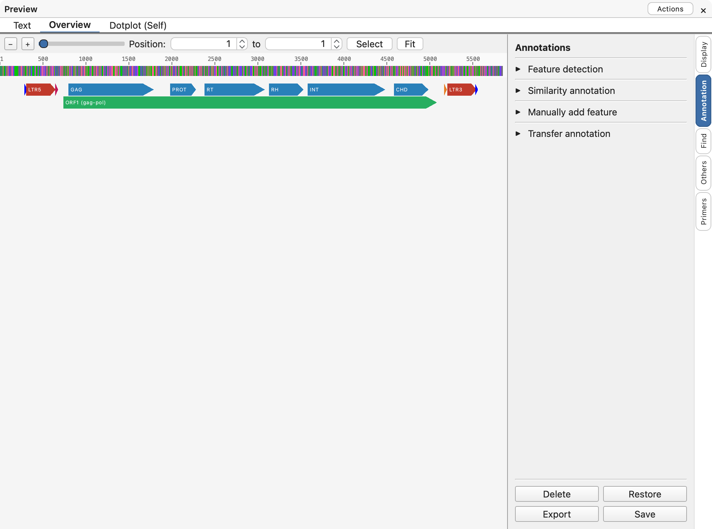
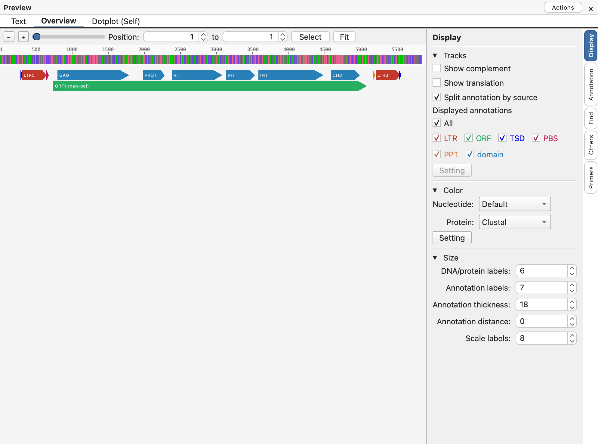
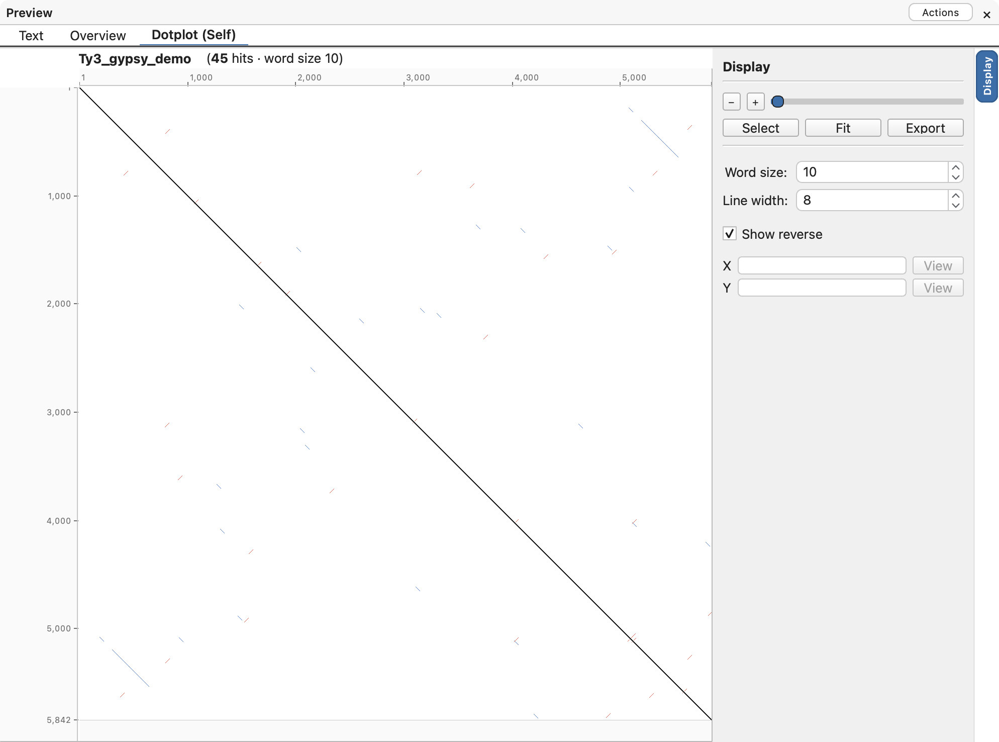
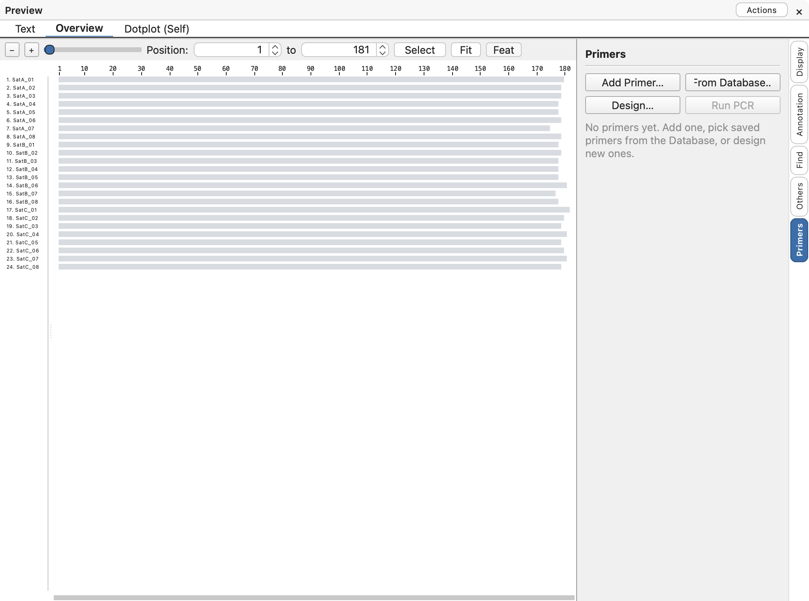
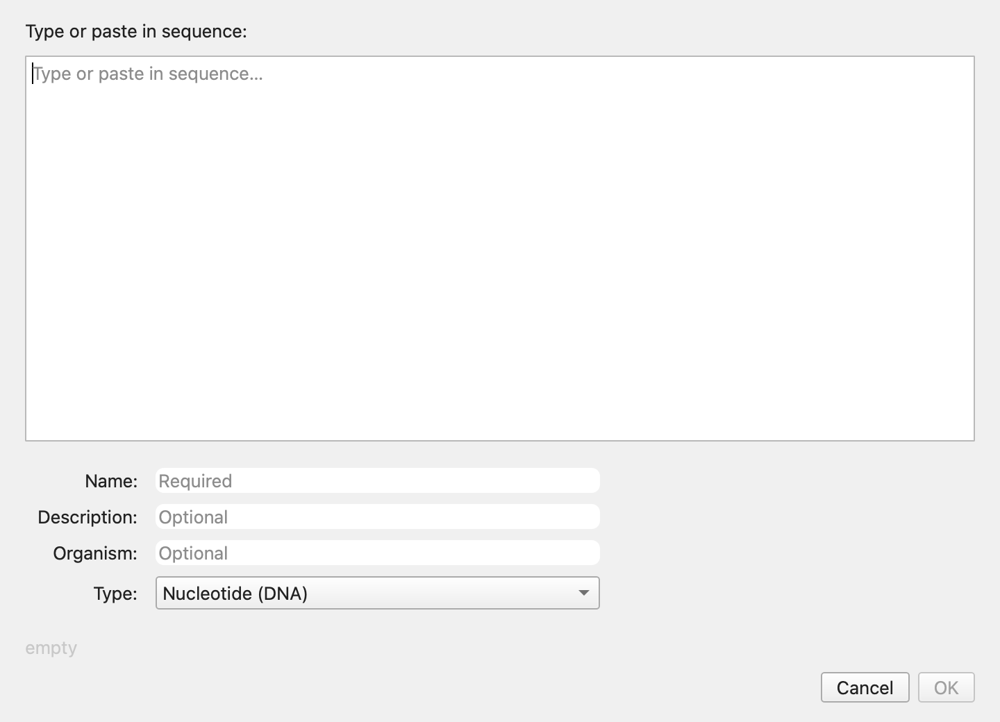
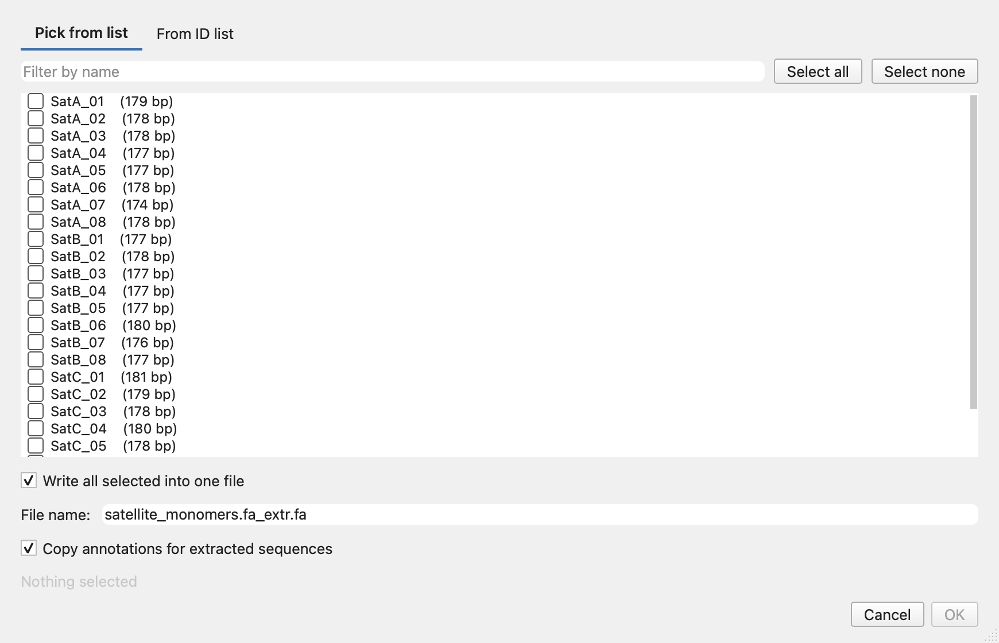
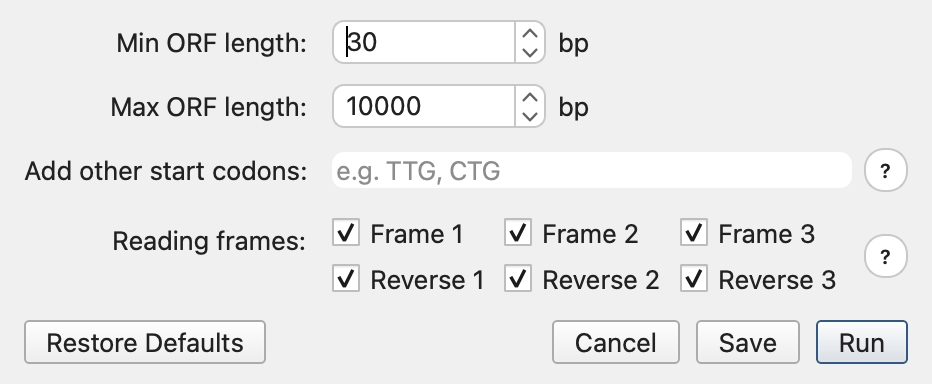
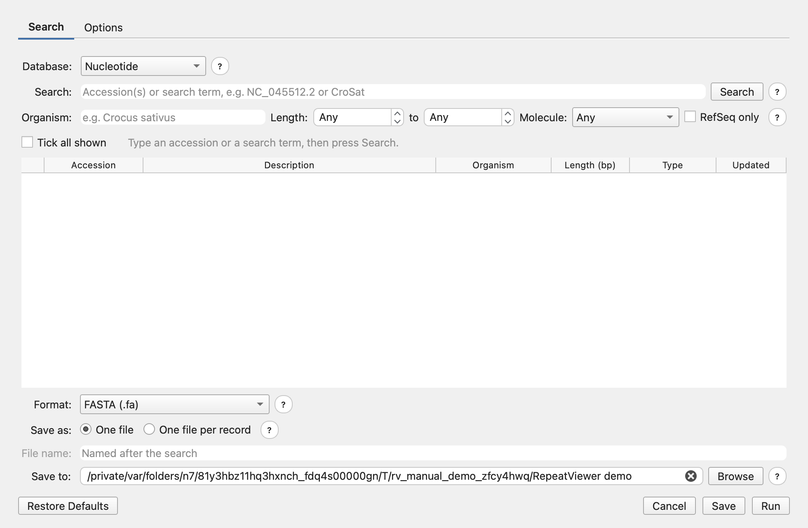

# Sequences

## Viewing a sequence

Click a FASTA file with one sequence. Preview shows three sub-tabs.

### Text

The sequence as text, with its length and GC content in the status line. Use
**Actions → Edit text** to change it in place and **Actions → Save text** to
save. The font size is set in **File → Setting → General → Files & preview**.

### Overview

A map of the sequence: a ruler, the bases (coloured, readable when you zoom
in), and the annotations as arrows in tracks. LTRs, TIRs, TSDs, ORFs, domains
and tandem repeats each have their own colour.

The bar above the map:

- **− / +** and the slider zoom; **Fit** shows the whole sequence.
- **Position … to …** shows the selected range; type numbers to select a range,
  **Select** selects it.
- **Length** and **GC** of the sequence.

Click a feature to select it; drag on the ruler to select a range;
double-click a position to zoom in to the bases. Hover a feature for its
details.

The side panel on the right has five tabs (click a tab again to hide the panel):

| Tab | Holds |
|-----|-------|
| **Display** | What is drawn and how: tracks, colours, sizes |
| **Annotation** | Feature detection, similarity annotation, manual features, transfer, Delete, Restore, Export, Save (see [Annotations](06-annotations.md)) |
| **Find** | Motif search in this sequence (see [Find](04-interface.md#find-and-go-to)) |
| **Others** | Reserved for extra options |
| **Primers** | Primers on this sequence and PCR (see [Primers and PCR](12-primers.md)) |

**Display** has three sections:

- **Tracks**: **Show complement** (the second strand under the first), **Show
  translation** (amino acids in the reading frames you choose), **Split
  annotation by source** (one track per program or file that made the
  features), and **Displayed annotations**: tick the feature types to show.
  **Setting** chooses the colour of each type.
- **Color**: the colour scheme for bases (**Nucleotide**) and amino acids
  (**Protein**, for example Clustal).
- **Size**: font sizes of base and amino-acid letters, annotation labels and
  the ruler, and the thickness and spacing of annotation arrows.

### Dotplot (Self)

The sequence against itself. The main diagonal is the sequence matching
itself. Short diagonals parallel to it in the corners are direct terminal
repeats (LTRs); short lines at right angles are inverted repeats (TIRs);
blocks of parallel lines are tandem repeats.

In the **Display** panel: **Word size** (length of exact matches drawn;
smaller finds more and is noisier), **Line width**, **Show reverse** (inverted
matches) and **X** / **Y** ranges with **View** to zoom to a region.
**Export** saves the plot as a figure. Zooming and moving never recalculate the
plot; only a new word size does.

## Several sequences in one file

A FASTA with several records opens as an overview: one row per record, with the
record names on the left and their annotations on the right, all on one ruler.
Click a row to select a record; the side panel then works on that record.

To work on one record by itself, right-click the file and choose **Separate
Sequence into N Files** (or **Folders**), or extract the records you want (see
below).

An aligned FASTA (all rows the same length, with gaps) opens in the alignment
viewer instead; see [Alignments](08-alignments.md#the-alignment-viewer).

## Sequence operations

The **Sequence** menu holds operations that make new FASTA files.

### New Sequence

Type or paste a sequence, give it a name (required), a description and an
organism, choose **Nucleotide (DNA)** or **Protein**, and click **OK**. The file
is written into the current folder (`.fa` for DNA, `.faa` for protein).

### Combine Sequences to One File

Select several FASTA files and merge them into one multi-FASTA, for example to
put curated consensus sequences together into a library.

### Extract Sequences from File

Picks records out of a multi-FASTA.

- **Pick from list**: tick records (filter by name, **Select all**,
  **Select none**).
- **From ID list**: give a text file with one name per line. Large files are
  read in the background.
- **Write all selected into one file**: one output (`<name>_extr.fa`) or one
  file per record.
- **Copy annotations for extracted sequences**: the features of each record go
  with it.

### Extract subject sequences from hit table

Select a BLAST hit table (`_bn.txt`) and choose this item (also on the table's
right-click menu) to cut the hit regions out of the genome the search ran
against. The genome is found from the link RepeatViewer writes next to BLAST
results, then from the project genome; only if both are missing are you asked
for it.

### Reverse Complement

Writes `<name>_rc.fa`. Candidates are often built on the wrong strand; check
this before you curate the ends.

### ORF Prediction

Finds open reading frames and writes `<name>_orfs.fa`.

| Setting | Default | Meaning |
|---------|---------|---------|
| Min ORF length | 30 bp | Shortest ORF reported |
| Max ORF length | 10000 bp | Longest ORF reported |
| Add other start codons | none | Extra start codons besides ATG, for example `TTG, CTG` |
| Reading frames | all six | Which frames to search |

ORFs are also found by **Feature detection** in the Overview, which is usually
the better place to look at them.

### Translate

Writes the protein translation as `<name>_translated.faa`.

## Download from NCBI

**Tools → Download from NCBI** searches NCBI and downloads sequences, proteins
or whole genome assemblies into the current folder, like Geneious' NCBI search.

1. Choose the **Database**: Nucleotide, Protein or Genome Assembly.
2. Type accessions (separated by spaces, commas or new lines; they are found and
   ticked directly) or a search term. Entrez syntax works, for example
   `Crocus[Organism] AND satellite`. GCA_/GCF_ accessions switch to Genome
   Assembly by themselves.
3. Narrow the search with **Organism**, **Length**, **Molecule** and **RefSeq
   only**; click **Search**. Results load page by page as you scroll.
4. Tick the records you want, choose the **Format** and whether to save **One
   file** or **One file per record**, and click **Run**.

| Database | Formats |
|----------|---------|
| Nucleotide | FASTA (`.fa`), FASTA with NCBI annotations, GenBank (`.gb`) |
| Protein | FASTA (`.faa`), GenPept (`.gp`) |
| Genome Assembly | FASTA, optionally with the GFF3 annotation (`<name>.gff3`) |

**FASTA with NCBI annotations** turns NCBI's feature table into RepeatViewer
annotations, so the genes and features show in the Overview at once.

File names: one record → `<accession>.fa`; several in one file → named after
the search; genomes → `<GCA accession>_<assembly name>.fa`. If files with these
names exist, you are asked whether to overwrite or skip them.

Downloads run on their own, outside the normal job queue: each has its own
progress bar and **Stop** button in the status bar, and other tools keep
working. Further downloads wait in a queue.

On the **Options** tab, an NCBI API key raises the request limit from 3 to 10
per second, and the right-click action can download accessions copied to the
clipboard with the saved settings.
