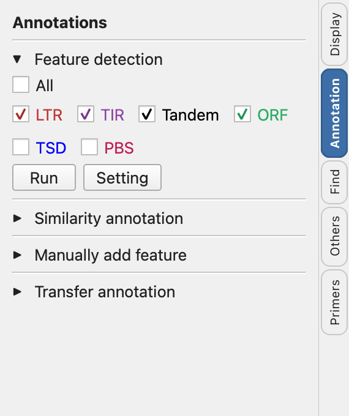
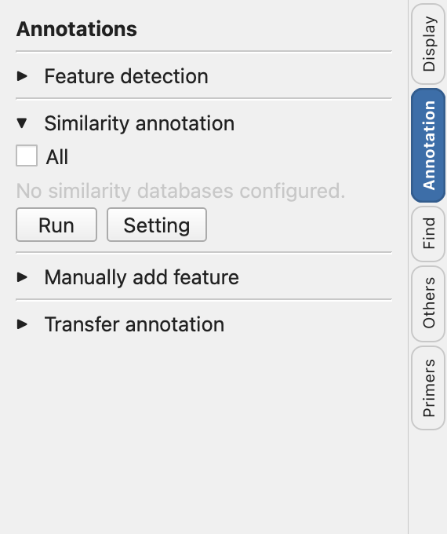
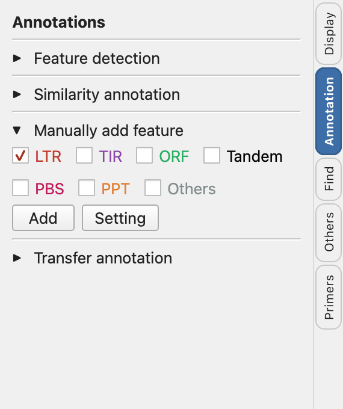
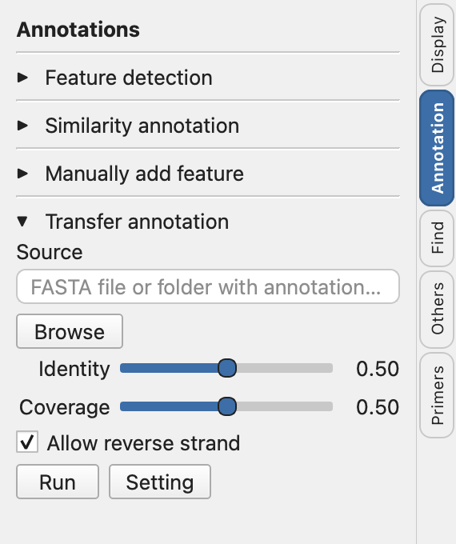
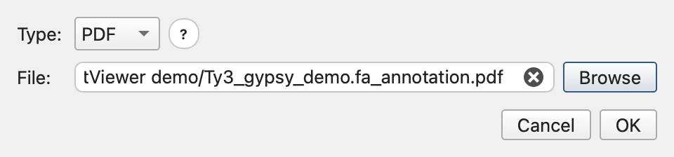
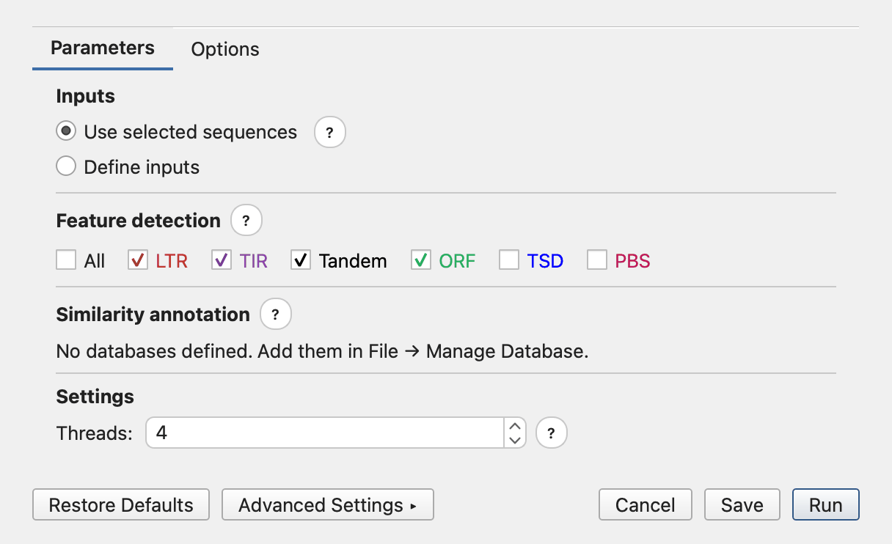
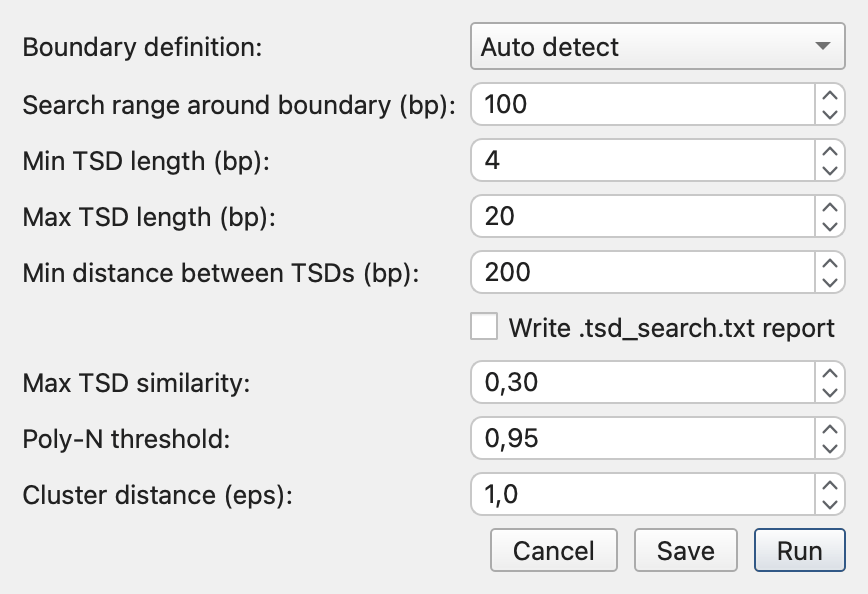

# Annotations

Annotations (features) are named regions of a sequence: LTRs, TIRs, TSDs,
protein domains, ORFs, tandem repeats, primer sites, or anything you mark by
hand. They are shown in the Overview and in the alignment viewer, and can be
moved between sequences and exported.

## Where annotations are stored

Every annotation of `name.fa` is saved in `name.seqmap_RV.json` next to it,
whether it came from feature detection, a similarity search, Find, a TSD search
or your own hand. This file keeps the colours, types and sources of the
features and is the one true copy. It is hidden in the Files panel and follows
its FASTA when you rename, move, copy or delete it.

GFF3, GTF and BED files are written only when you export (see
[Export](#export)). To get a GFF3 on every save as well, tick **Also write GFF3
on every Save** in the export window; the file is then `name.fa_RV.gff3`.

### Adding an existing annotation file

Drag a GFF, GFF3, GTF or BED file onto the FASTA in the Files panel, or
right-click the FASTA and choose **Add Annotation…**. Features are matched to
records by sequence name (GFF column 1 = the FASTA header up to the first
space), so the annotation file can have any name. The file itself is not moved
or changed.

## The Annotation tab

Open a FASTA, switch to **Overview**, and open the **Annotation** tab of the
side panel. It has four sections; click a title to open it.

### Feature detection

Finds structural features in the current sequence in a few seconds, without
any database. Tick what to look for and click **Run**:

| Type | What is found |
|------|---------------|
| LTR | Long terminal repeats: direct repeats at both ends |
| TIR | Terminal inverted repeats |
| Tandem | Tandem repeats (with pytrf) |
| ORF | Open reading frames |
| TSD | Target site duplications next to LTRs or TIRs |
| PBS | Primer binding sites (tRNA matches) just inside a 5′ LTR |

**Setting** opens the parameters of each detector (minimum lengths,
identities, ORF size and so on).

### Similarity annotation

Searches the sequence against your annotation databases (protein domains such
as CDD or REXdb, HMM profiles such as Pfam or Dfam, or a TE library) and adds
the hits as features. Which databases appear here is set in **File → Manage
Database** with the **Annotation** tick (see
[Manage Database](07-search.md#manage-database)). **Setting** sets E-values and
other thresholds.

### Manually add feature

Select a range on the ruler (drag), tick the feature type, and click **Add**.
**Setting** chooses which types are listed.

Right-click a feature for **Modify** (name, type, strand, range), **Change
color**, **Copy sequence**, **Extract Sequence** (write it to a new FASTA),
**Attach cytogenetic image…** and **Delete**. Drag a selected feature's end to
change its range. Right-click a selected range of the ruler for **Add
feature…**, **Copy Sequence** and **Extract Sequence**.

### Transfer annotation

Copies annotations from an annotated sequence (the source) onto the current
sequence, for example from a curated reference element onto a new copy.

- **Source**: click an annotated FASTA in the Files panel (or a folder in the
  Folders panel to use every annotated sequence in it), or **Browse**.
- **Identity** and **Coverage**: how similar a feature's sequence must be, and
  how much of it must be found, to be transferred.
- **Allow reverse strand**: also transfer onto the other strand.
- **Selected features only** (when shown): transfer only the features selected
  on the source.

The whole source is lifted onto the target first (MAFFT for short sequences,
minimap2 for long ones), and any features left over are placed by BLAST.
Transferred features remember their identity and coverage.

### Delete, Restore, Export, Save

- **Delete**: remove the selected features.
- **Restore**: go back to the last saved state.
- **Save**: write the annotations to `name.seqmap_RV.json`. The button reads
  **Save •** while there are unsaved changes, and RepeatViewer asks before you
  leave a file with unsaved annotation changes.
- **Export**: see below.

## Export

**Export** in the Annotation tab, in the alignment viewer and in the
multi-sequence overview, and **Export Annotation…** on a FASTA's right-click
menu, all open the same window.

| Type | Writes |
|------|--------|
| GFF3, GTF, BED | The annotations as on screen, including unsaved changes |
| PDF, SVG | The current view as a vector figure, ready for a journal |
| PNG | The current view as an image, at the DPI you choose |

The suggested file name follows the type: `name.fa_RV.gff3` for annotations,
`name.fa_annotation.pdf` for figures.

## Sequence Annotation (many files at once)

**Tools → Annotate → Sequence Annotation** runs feature detection and
similarity annotation on all selected files in one go, writing the results into
each file's annotations. Use it to annotate a whole library before you look at
the elements one by one.

- **Feature detection**: the same types as in the side panel.
- **Similarity annotation**: the databases marked for annotation.
- **Threads** and, under **Advanced Settings**, the detector parameters.

## TSD Search

**Tools → Annotate → TSD Search** looks for target site duplications in an
alignment of genomic copies: short direct repeats just outside the element, one
on each side. A TSD found in many copies is strong evidence that the boundaries
are right.

| Setting | Default | Meaning |
|---------|---------|---------|
| Boundary definition | Auto detect | Where the element starts and ends: found by boundary prediction, or set as alignment columns |
| Search range around boundary | 100 bp | How far outside each boundary to look |
| Min / Max TSD length | 4 / 20 bp | Lengths of TSD considered |
| Min distance between TSDs | 200 bp | The two copies must be at least this far apart |
| Write .tsd_search.txt report | off | Also write a text report |
| Max TSD similarity | 0.30 | Similarity ceiling used when comparing candidates |
| Poly-N threshold | 0.95 | Ignore candidates in runs of N |
| Cluster distance (eps) | 1.0 | Tolerance when grouping candidates from many copies |

The TSDs found are added as `TSD` features on the alignment.
