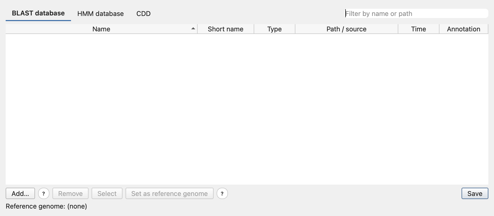
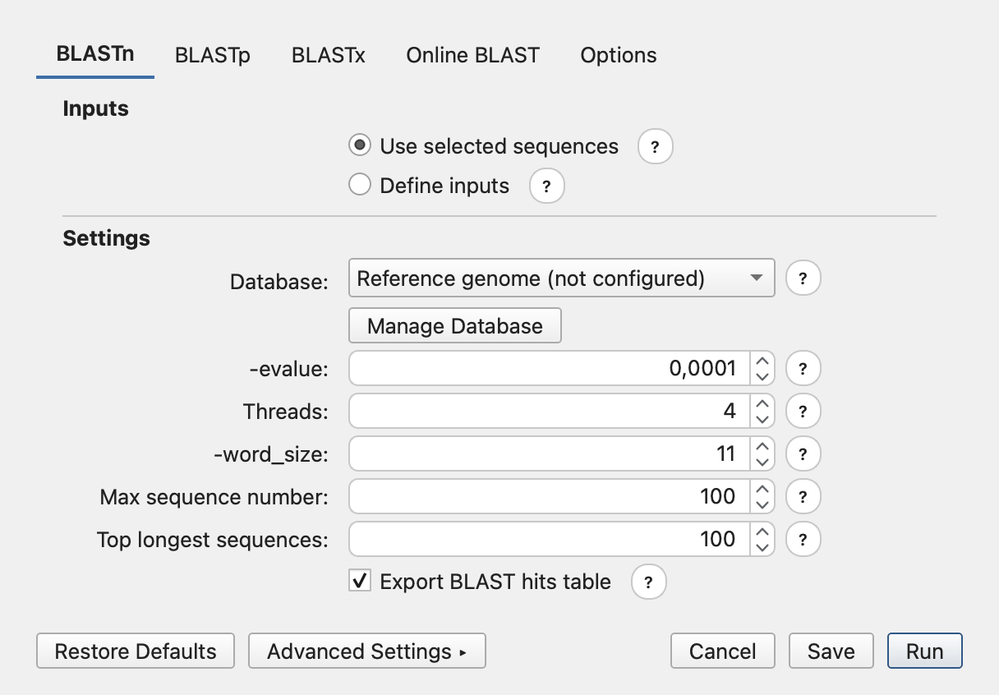
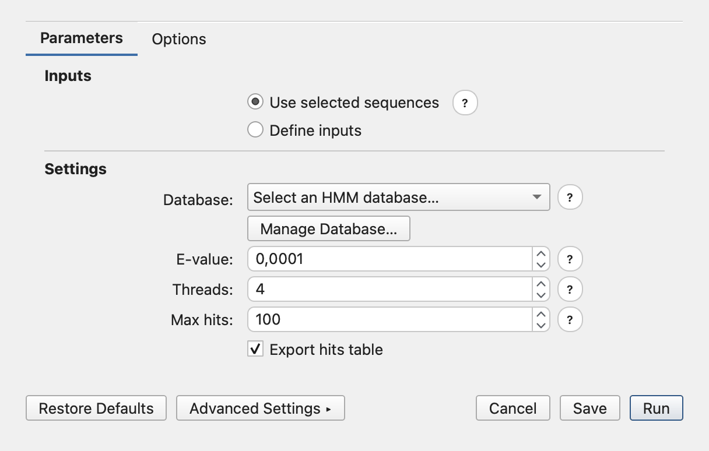

# Search

## Manage Database

**File → Manage Database…** (**⇧⌘G** / **Ctrl+Shift+G**) keeps the genomes,
sequence libraries and profile databases your searches use. The same window
opens from the **Manage Database** buttons in the BLAST, HMMER, TE-Aid and MSA
Extend windows.

The window has three tabs:

| Tab | Holds | Used by |
|-----|-------|---------|
| **BLAST database** | FASTA DNA (genomes, TE libraries) and FASTA Protein (protein libraries such as REXdb) | BLAST, TE-Aid, MSA Extend, similarity annotation |
| **HMM database** | HMM DNA and HMM Protein profile files (Pfam, Dfam) | HMMER, similarity annotation |
| **CDD** | NCBI Conserved Domain Database folders | Similarity annotation (RPS-BLAST) |

Columns: **Name** (defaults to the file name), **Short name** (up to 15
characters, the label used for its features; `-` when empty), **Type**,
**Path / source**, **Time** (when it was added) and **Annotation** (tick to use
it in similarity annotation). Click a header to sort; type in the filter box to
find an entry.

- **Add…**: choose a file and its **Type**. The type decides which tab it goes
  to; every type can be added from every tab. While the window is open, clicking
  a FASTA in the Files panel fills the path. BLAST indexes are built in the
  background into the **BLAST databases** folder set in
  **File → Setting → General**.
- **Remove**: forget the selected entries (the original files stay).
- **Set as reference genome**: make the selected FASTA DNA the project genome.
  Tools that compare with "the genome" (BLAST, MSA Extend, TE-Aid, boundary
  prediction, genome plots) use it. The current reference genome is named under
  the table. A chromosome sizes file is written for every FASTA DNA database.
- **Annotation**: tick to show the database in the Annotation tab's similarity
  search.

A FASTA can also be added straight from the Files panel: right-click → **Add as
BLAST Database…**.

## BLAST

**Toolbar: BLAST · Tools → Search → BLAST**

Searches the selected sequences against the reference genome or a saved
database with BLAST+ (bundled).

The window has a tab per program: **BLASTn** (DNA against DNA), **BLASTp**
(protein against protein), **BLASTx** (translated DNA against protein) and
**Online BLAST**, plus **Options**. **Run** runs the tab you are on. Each
selected file is searched separately.

| Setting | Default | Meaning |
|---------|---------|---------|
| Database | Reference genome | The genome, or a saved BLAST database; **Manage Database** adds one |
| -evalue | 0.0001 | E-value cut-off; lower keeps fewer, more significant hits |
| Threads | CPU count minus the reserve | `-num_threads` |
| -word_size | 11 (BLASTn) | Seed length. Smaller is more sensitive and much slower on repetitive genomes |
| Max sequence number | 100 | At most this many hit sequences go into the extracted FASTA |
| Top longest sequences | 100 | Of those, this many are the longest hits; the rest are picked at random |
| Export BLAST hits table | on | Keep the tabular hit table |
| Advanced: -gapopen, -gapextend, -penalty, -perc_identity, -qcov_hsp_perc | BLAST+ defaults | Gap and mismatch costs, minimum identity and query coverage |

**Max sequence number** and **Top longest sequences** matter for high-copy
elements: without a cap, a family with thousands of copies gives an alignment
too big to work with. Taking the longest copies first keeps full-length copies
in the set. Option meanings follow the
[NCBI BLAST+ user manual](https://www.ncbi.nlm.nih.gov/books/NBK279690/).

**Outputs** (next to the query; `bn` for BLASTn, `bp` for BLASTp, `bx` for
BLASTx):

| File | Contents |
|------|----------|
| `<name>_bn.txt` | Tabular hit table (outfmt 6). Input for the genome plots |
| `<name>_bn.txt.fa` | The hit regions cut out of the genome: the input for Align |
| `<name>_bn.gff` | Hit positions as GFF, when GFF output is on |

### Online BLAST

The **Online BLAST** tab sends one sequence to NCBI's servers, for example to
see whether a new satellite or TE matches anything known.

| Setting | Meaning |
|---------|---------|
| Program | blastn, blastp, blastx, tblastn or tblastx |
| Database | NCBI databases as on the BLAST website: core_nt (default), nt, refseq, nr, swissprot and others |
| Max hits | How many hits NCBI returns |
| Export BLAST hits table | Also keep the table `<name>_obn.txt` |

Each query file must hold one sequence (split a multi-FASTA first with
right-click → **Separate Sequence into N Files**). The result is an HTML report,
`<name>_obn.html`, which opens in Preview. Hits can also be added to the
sequence as annotations, coloured by identity.

## HMMER

**Tools → Search → HMMER**

Searches the selected sequences against an HMM profile database (Pfam, Dfam,
REXdb domain profiles) with pyhmmer.

| Setting | Default | Meaning |
|---------|---------|---------|
| Database | | An HMM database from Manage Database |
| E-value | 0.0001 | Reporting threshold |
| Threads | | Parallel threads |
| Max hits | 100 | Most hits kept per query |
| Export hits table | on | Write the hit table |

Protein profiles are searched against the ORFs of DNA queries. The hit table is
written as `<name>_hmmer.txt` next to the query (`_hmmer1.txt`, `_hmmer2.txt`,
… on later runs).
