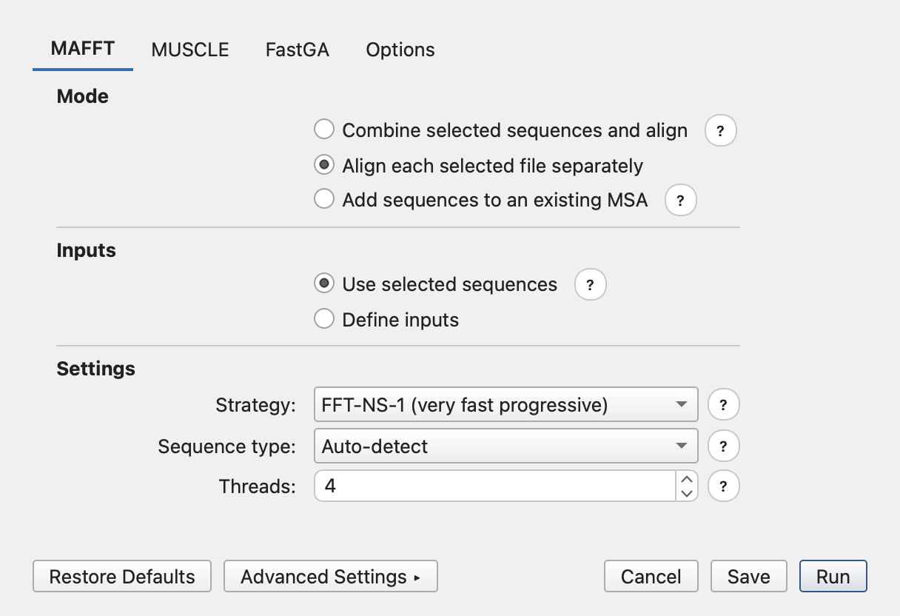
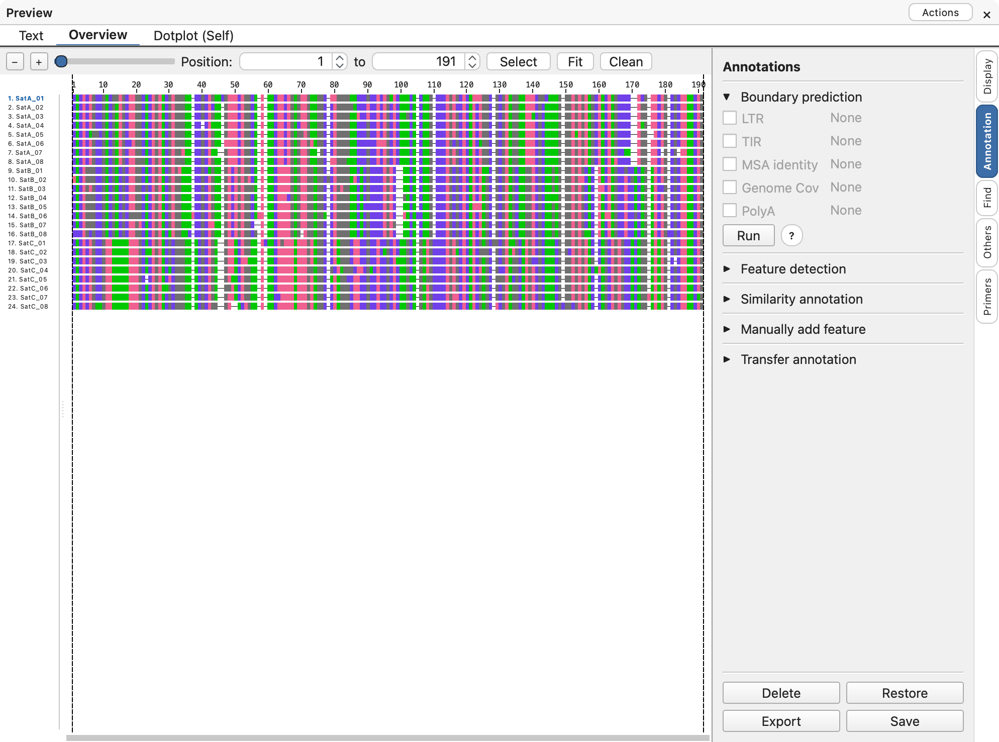
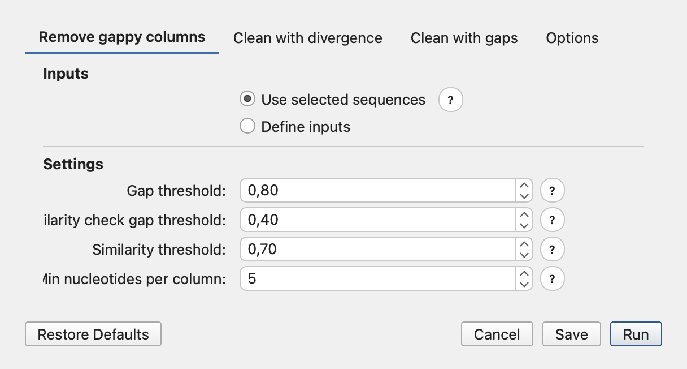
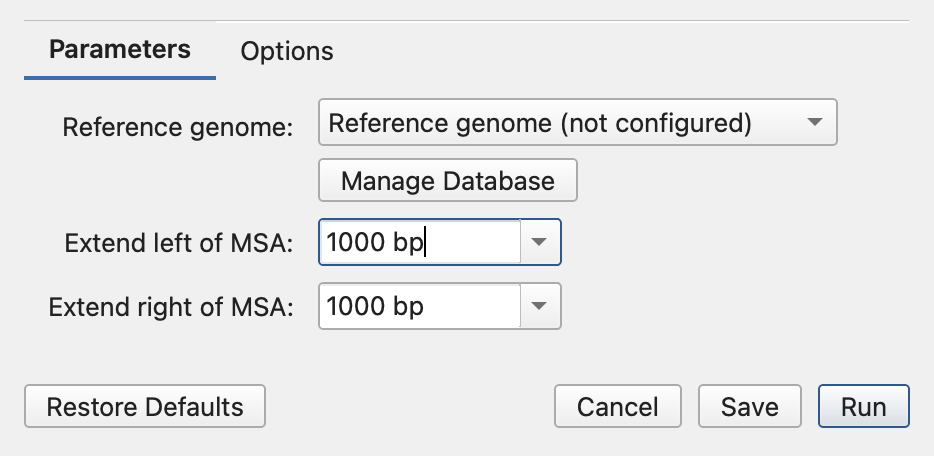
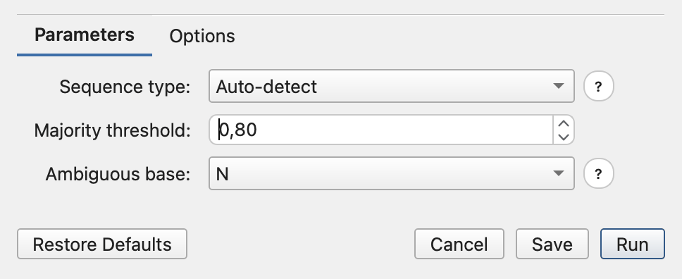
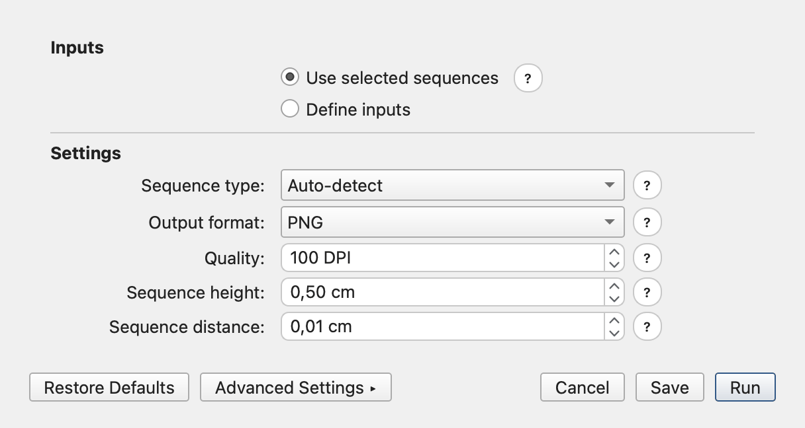

# Alignments

## Align

**Toolbar: Align · Tools → Align**

Builds a multiple sequence alignment (MSA) with **MAFFT** or **MUSCLE** (both
bundled), or a whole-genome style alignment with **FastGA**. The Tools menu has
**MAFFT**, **MUSCLE** and **FastGA** (run with saved settings), **Align all
selected files in one MSA**, and **Change alignment parameters** (the window).

The window has the tabs **MAFFT**, **MUSCLE**, **FastGA** and **Options**;
**Run** runs the tab you are on. **Options** sets what right-clicking the Align
button runs.

### MAFFT and MUSCLE

**Mode**:

- **Combine selected sequences and align**: all selected files go into one
  alignment.
- **Align each selected file separately**: one alignment per file.
- **Add sequences to an existing MSA** (MAFFT): new sequences are added to an
  alignment without realigning it (`--add`).

| MAFFT setting | Meaning |
|---------------|---------|
| Strategy | FFT-NS-1, FFT-NS-2 (fast, progressive), L-INS-i, G-INS-i, E-INS-i (iterative, accurate, for up to a few hundred sequences), Auto, or Custom |
| Sequence type | Auto-detect, nucleotide or protein |
| Threads | `--thread` |
| Advanced: `--retree`, `--maxiterate` | Guide-tree rebuilds and refinement cycles (Custom) |
| Advanced: `--op`, `--ep` | Gap opening penalty and offset |
| Advanced: `--reorder`, `--adjustdirectionaccurately` | Output order, and turning copies from the other strand |

Strategy meanings follow the
[MAFFT algorithms page](https://mafft.cbrc.jp/alignment/software/algorithms/algorithms.html).
For TE copies from both strands, switch on
`--adjustdirectionaccurately`; otherwise reversed copies look extremely
divergent.

| MUSCLE setting | Meaning |
|----------------|---------|
| Algorithm | `-align` (most accurate) or `-super5` (large sets) |
| Threads | `-threads` |
| Advanced: guide tree permutation, perturbation seed | `-perm` and `-perturb` |

**Outputs:** one file aligned → `<name>_mafft.fa` / `<name>_muscle.fa`;
combined → `<name>_cmafft.fa` / `<name>_cmuscle.fa`. The alignment opens in the
alignment viewer.

### FastGA

FastGA aligns large sequences (chromosomes, genomes) much faster than BLAST and
writes alignments for a dotplot. It is not bundled; install **FastGA 1.5 or
newer** (see [Installation](02-installation.md#optional-external-programs)).
On Windows it runs in WSL.

| Mode | Runs | Output (next to the input) |
|------|------|----------------------------|
| Each file against itself | one run per selected file | `<file>_FastGA.paf` |
| Selected files against each other | every pair (A–B, A–C, B–C) | `<first>_multi_FastGA.paf` |
| Selected files against a reference | one run per selected file | `<file>_FastGA_vs_<reference>.paf`, or with **Write all into one file** `<first>_multi_FastGA_vs_<reference>.paf` |

For **against a reference**: select the files to compare, open the window, then
click the reference in the Files panel (or **Browse**). The files compared are
the ones selected when the window opened; the reference is skipped if it is
among them. A grey line says what **Run** will do, for example
"3 FASTA selected → 3 runs against genome.fa". The reference is indexed once
and reused; with **Keep genome index** the index is kept in a hidden
`.repeatviewer_fastga` folder next to the reference (about 14 GB per gigabase).

| Setting | Meaning |
|---------|---------|
| Output format | PAF variants, PSL, or binary `.1aln`. PAF and `.1aln` open as a dotplot |
| `-T` threads, `-i` min identity, `-l` min length | Speed and filters |
| `-f` seed cutoff | Seeds more frequent than this are dropped. RepeatViewer uses 200 (FastGA: 10) so repeats stay visible |
| `-c` / `-s` | Chain coverage and chain gap |
| Symmetric seeding (`-S`) | Result does not depend on the order of the files |
| Use soft mask | Seed only in upper-case bases |
| Temp dir (`-P`) | Where FastGA writes its large temporary files |

## The alignment viewer

An aligned FASTA opens in the alignment viewer: sequence names on the left
(numbered), the alignment on the right with a ruler, coloured bases, and
annotations under the rows.

The bar above the alignment:

| Control | What it does |
|---------|--------------|
| − / + and slider | Zoom |
| Position … to … | Shows the selected columns; type a range and click **Select** to zoom to it |
| **Fit** | Fit the longest row to the window |
| **Clean** | Open MSA Clean for this alignment |
| **Cons** | Open Consensus for this alignment |
| **Cov** | Build a consensus, BLAST it against the project genome and draw TE-Aid style coverage above the alignment |
| **Feat** | Show or hide all feature tracks |

Selecting:

- Click a name to select a row; **⌘**-click or **Shift**-click for more rows.
- Drag on the alignment to select a block of columns.
- **Delete** removes the selected rows, or the selected columns (from the
  selected rows or from all), after asking. **⌘Z** undoes it.

Right-click a sequence name for **Rename sequence**, **Set as reference** (the
row the others are compared with), **Copy Sequence** / **Copy Sequence without
gap**, **Extract Sequence** / **Extract Sequence without gap**, **Show
self-dotplot** and **Add feature…**.

The side panel has the same tabs as for a single sequence (Display, Annotation,
Find, Others, Primers). In the alignment viewer the Annotation tab adds
**Boundary prediction**.

### Boundary prediction

Suggests where the element starts and ends in the alignment, with the methods
of TEtrimmer. The alignment is first cleaned (rare bases below 1 % become gaps;
gappy or poorly conserved columns are removed), then:

| Row | How the boundary is found |
|-----|---------------------------|
| **LTR / TIR** | The 0.7 consensus is BLASTed against itself. Direct repeats of at least 100 bp at both ends give an LTR, inverted repeats of at least 20 bp a TIR |
| **MSA identity** | Ends with low conservation are cut, then the boundary is the first and last 4-column window whose 0.8 consensus has no N |
| **Genome Cov** | The 0.7 consensus is BLASTed against the project genome; the boundary is where coverage rises above the background at each end. Needs a reference genome |
| **PolyA** | Only for files whose name contains LINE or SINE: a run of 10 or more A near the 3′ end, followed by unconserved sequence |

Click **Run**, then tick a row to draw its boundary as lines on the alignment.
TSD Search with **Auto detect** uses these boundaries.

## MSA Clean

**Toolbar: MSA Clean · Tools → Curate → MSA Clean**

Removes the rows and columns that make an alignment of genomic copies hard to
read. Three steps, each on its own tab, can be run alone or together
(**Tools → Curate → MSA Clean → Combined MSA clean**).

| Step | Removes | Main settings |
|------|---------|---------------|
| **Remove gappy columns** | Columns that are mostly gaps | Gap threshold (0.80), similarity check gap threshold (0.40), similarity threshold (0.70), min nucleotides per column (5) |
| **Clean with divergence** | Rows too different from the alignment's consensus | Divergence threshold, window size |
| **Clean with gaps** | Rows that are mostly gaps | Gap proportion threshold |

Each step writes its own file, so you can see what each one removed and go back
one step without redoing the others:

| File | Step |
|------|------|
| `<name>_gap.fa` | Gappy columns removed |
| `<name>_rowdiv.fa` | Divergent rows removed |
| `<name>_rowgap.fa` | Gappy rows removed |

On the **Options** tab, **Right-click action** chooses which step (or the
combined clean) runs when you right-click the toolbar button.

## MSA Extend

**Toolbar: MSA Extend · Tools → Curate → MSA Extend**

Adds genomic sequence to both ends of every copy in an alignment, so you can see
whether the element continues beyond the current ends. This is how truncated
ends and incomplete terminal repeats are recovered.

| Setting | Default | Meaning |
|---------|---------|---------|
| Reference genome | the project genome | Where the flanking sequence comes from (a genome or pan-genome) |
| Extend left of MSA | 1000 bp | Bases added on the 5′ side |
| Extend right of MSA | 1000 bp | Bases added on the 3′ side |

The usual rhythm: extend, clean, look at the new ends, extend again, until the
alignment ends where the copies stop agreeing.

## Consensus

**Toolbar: Consensus · Tools → Curate → Consensus**

Collapses an alignment into one sequence.

| Setting | Default | Meaning |
|---------|---------|---------|
| Sequence type | Auto-detect | Nucleotide or protein |
| Majority threshold | 0.80 | Fraction of rows that must agree for a base to be called |
| Ambiguous base | N | Written where no base reaches the threshold (X for protein) |

Consensus needs an alignment (all rows the same length) or a single sequence; an
unaligned multi-FASTA is refused with a message to align it first.

**Output:** the threshold is part of the name, for example
`CroSat2.fa_mafft.fa_0.8_co.fa`, so consensus sequences at several thresholds
can be compared in one folder.

## MSA plot

**Tools → Visualize → MSA plot** draws an overview image of an alignment for a
figure: one coloured bar per row.

| Setting | Meaning |
|---------|---------|
| Sequence type | Auto-detect, nucleotide or protein |
| Output format, Quality | PNG (with DPI) or PDF |
| Sequence height, Sequence distance | Row height and space between rows, in cm |
| Advanced | Colours for each base or amino acid, with presets |

**Output:** `<name>_msa_plot.png` or `<name>_msa_plot.pdf`.

## Open in AliView

**Tools → Open in AliView** (or right-click a file) opens the alignment in
[AliView](https://ormbunkar.se/aliview/), for editing by hand. Set AliView's
location in **File → Setting → General → Sequence tools**.
