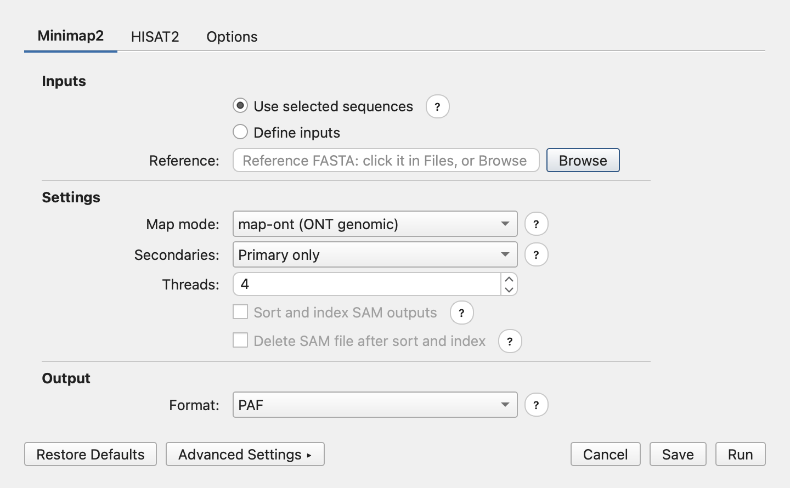
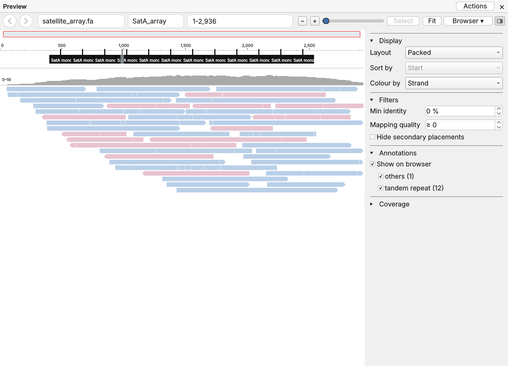
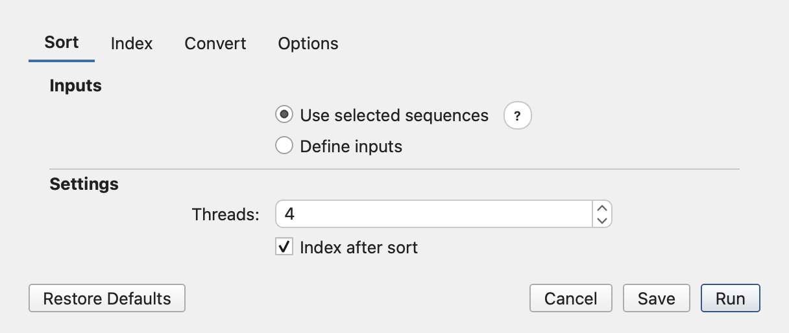
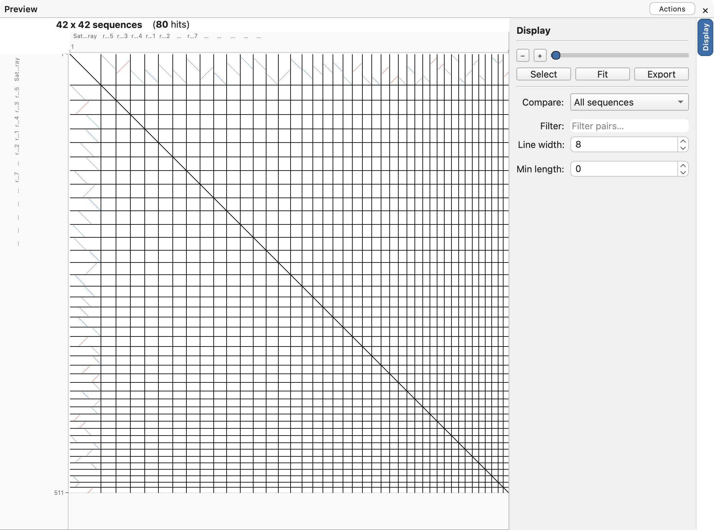
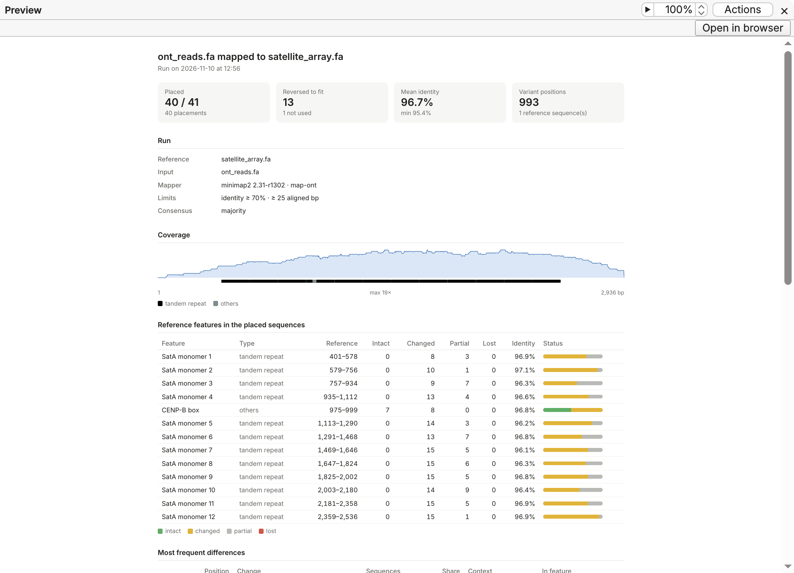

# Mapping

**Tools → Mapping** (add the **Mapping** button in **File → Setting → Toolbar**)

Places reads, contigs or repeat copies on a reference and shows where they
differ, like Geneious' *Map to Reference*. Typical uses: nanopore reads on a
satellite array or a TE consensus, assembled contigs on a reference element,
RNA-seq reads on a TE to see which parts are expressed.

## Running a mapping

1. Select the reads or sequences to map in the Files panel (FASTA or FASTQ,
   gzipped files too), or use **Define inputs**.
2. Open the window and click the **Reference** FASTA in the Files panel (or
   **Browse**). If a reference genome is set, it is filled in.
3. Choose the mapper tab, check the settings, click **Run**.

Two mappers:

- **minimap2** (bundled, version 2.31): long reads (ONT, PacBio HiFi or CLR),
  assembled contigs, cDNA and long RNA.
- **HISAT2** (install it yourself, 2.2 or newer): short Illumina DNA or RNA-seq
  reads, including spliced RNA. HISAT2 builds its index once and keeps it in a
  hidden `.repeatviewer_hisat2` folder next to the reference.

If the mapper you chose is missing, the run stops with an install hint.

### Minimap2 settings

| Setting | Default | Meaning |
|---------|---------|---------|
| Map mode (`-x`) | map-ont | The minimap2 preset. Changing it fills `-k` and `-w` |
| Secondaries | Primary only | Keep only the best place of each read, or also other equally good places (`-N 50`) |
| Threads | CPU count | `-t` |
| Output format | PAF | PAF (opens as a dotplot) or SAM (opens in the genome browser) |
| Sort and index SAM outputs | off | Turn the SAM into a coordinate-sorted `*.sorted.bam` with a `.bai` index, so the genome browser reads it piece by piece instead of the whole file. Only for SAM output |
| Delete SAM file after sort and index | off | Keep only the sorted BAM and its index, to save disk space |
| Advanced: `-k`, `-w` | from the preset | Seed length and window |
| Advanced: CIGAR / CS | on for PAF | `-c` and `--cs=long`; needed to show the differences |
| Advanced: repetitive seeds | Default | **Keep more** (`-f 0.00002`) or **Keep all**: minimap2 ignores its most frequent seeds by default, which hides hits inside tandem arrays. Use Keep more for satellites |

Map modes:

- **Long genomic reads**: `map-ont` (ONT), `map-pb` (PacBio CLR), `map-hifi`
  (HiFi), `lr:hq` (nanopore Q20), `map-iclr` (Illumina Complete Long Reads).
- **RNA and cDNA**: `splice` (long RNA or cDNA), `splice:hq` (Iso-Seq),
  `splice:sr` (short RNA-seq).
- **Assemblies and short DNA**: `asm5`, `asm10`, `asm20` (about 0.1, 1 and 5 %
  divergence), `sr` (short genomic reads).

### HISAT2 settings

| Setting | Default | Meaning |
|---------|---------|---------|
| Library | RNA-seq (spliced) | Or DNA-seq (`--no-spliced-alignment`) |
| Reads | Single-end | Or paired-end; R1 and R2 are paired by their file names |
| Strandness | Unstranded | F or R (single-end), FR or RF (paired-end) |
| Report | Best place only | Or up to 20 places (`-k 20`) |
| Sort and index SAM outputs, Delete SAM file after sort and index | off | As for minimap2 (HISAT2 always writes SAM) |
| Advanced | | `--dta`, minimum and maximum intron length, `--no-softclip` |

### Filters and outputs (Advanced Settings)

A placed read is kept only if it passes all filters: **minimum identity**
(default 70 % of aligned columns match), **minimum aligned length** (25 bp) and
**minimum mapping quality**. Reads that fail, or that do not map, are listed as
not used, with the reason. Further settings choose the consensus threshold
(majority by default), the minimum variant frequency in the variants table,
which files to write, and whether to move the reference annotations onto the
mapped reads.

Reference names must be unique: mappers report hits by name, so two records
with the same name would mix up their hits. RepeatViewer stops with a message if
the reference has repeated names.

## What is written

The mapper's alignment and the contig document sit next to the input. Optional
consensus / placed / unused FASTA and the variants table are written beside
them when those options are on. A temporary `_details/` workspace is used
while the run works, then deleted:

| File | Contents |
|------|----------|
| `<input>_minimap.paf` or `.sam` | The mapper's alignment (opens in Preview) |
| `<input>_minimap.rvmap` | Contig-view snapshot of the run |
| `…_consensus.fa` | Consensus of the mapped reads (optional) |
| `…_mapped.fa` | The placed reads, on the reference strand (optional) |
| `…_unused.fa` | Reads not placed (optional) |
| `…_variants.tsv` | Differences table (optional) |

A `<input>_minimap.rvmap` (or `_hisat`) contig document next to the alignment
opens in Contig view. A second run writes `_2`; nothing is overwritten. No
samtools or pysam is needed for Mapping itself.

## The genome browser (SAM, BAM, CRAM)

A SAM result opens in the genome browser. BAM and CRAM files from other tools,
and GFF, GTF and BED files, open there too. For large mappings, sort and index
first (see [Samtools](#samtools-sort-index-convert)).

The navigation bar: back and forward, the file, the sequence (choose another
reference sequence), the range shown (type a range to go there), − / + and
slider, **Select**, **Fit**, **Browser ▾** and the side panel button.

- Reads are drawn as arrows, packed into rows, coloured by strand; differences
  from the reference are marked on them.
- Above the reads: the reference ruler, its annotations and the coverage.
- Hover a read or a position for details; right-click for **Copy Position**,
  **Zoom to This**, **Zoom In**, **Zoom Out**, **Whole Sequence**, and on a
  read name **Copy name**, **BLAST sequence…**.
- The reference is the project genome when its names match the file;
  otherwise choose one with **Browser ▾ → Choose FASTA…**. The choice is
  remembered for the file.

Side panel:

| Section | Settings |
|---------|----------|
| Display | Layout (Packed or one read per row), Sort by, Colour by (Strand, Identity, Mapping quality) |
| Filters | Min identity, Mapping quality, Hide secondary placements |
| Annotations | Show the reference features, per type |
| Coverage | Coverage track options |

The browser is read-only: it shows, it does not edit.

## Samtools: sort, index, convert

**Tools → Samtools**

Prepares alignment files (SAM, BAM, CRAM, also `.sam.gz`) from RepeatViewer's
Mapping or from any other mapper, mostly so that large files open quickly in the
genome browser. **Tools → Samtools** opens the window; use the **Sort**,
**Index** or **Convert** tab and **Run**.

| Tab | Does | Output (next to the input) |
|-----|------|----------------------------|
| **Sort** | Sorts the alignments by position into a BAM. **Index after sort** (on by default) also builds the index | `<name>.sorted.bam` and `<name>.sorted.bam.bai` |
| **Index** | Builds the index of a BAM or CRAM that is already sorted by position | `.bai` (BAM) or `.crai` (CRAM) |
| **Convert** | Rewrites between SAM, BAM and CRAM without sorting (**Output format**, default BAM). Files already in that format are skipped. A CRAM may need its reference | `<name>.bam`, `.sam` or `.cram` |

`<name>` is the file name without `.sam`, `.bam` or `.cram`. **Threads** is
shared by the three tabs. With an index next to it, a BAM opens in the genome
browser window by window, which is much faster for large mappings. Index files
follow their BAM or CRAM when you rename it.

Samtools work is done with **pysam** on macOS and Linux (`pip install pysam`),
or with a samtools program on the PATH. On Windows, RepeatViewer uses the
[Win-NGS samtools bundle](https://github.com/win-ngs/samtools-windows-bundle/releases):
download and unzip it, then choose `samtools.exe` on the **Options** tab or add
its folder to PATH.

## The dotplot (PAF)

A PAF result opens as an alignment dotplot: the reads and the reference along
the axes, each hit as a line. The **Display** panel sets which pairs are shown
(**Compare**), a name filter, line width and minimum length. This view is
useful for seeing where long reads or contigs cross a repeat array.

## The report

The report shows four numbers at the top (placed, reversed, mean identity,
variant positions), the run details, the coverage along the reference with the
features under it, and a table of the reference features with how often each
is **intact**, **changed** (n differences), **partial** (only part covered) or
**lost** (half or more deleted) in the reads. Then the most frequent
differences, with their cytosine context (CG, CHG), where methylation-driven
C→T changes are expected. The full list is in `…_variants.tsv`.
