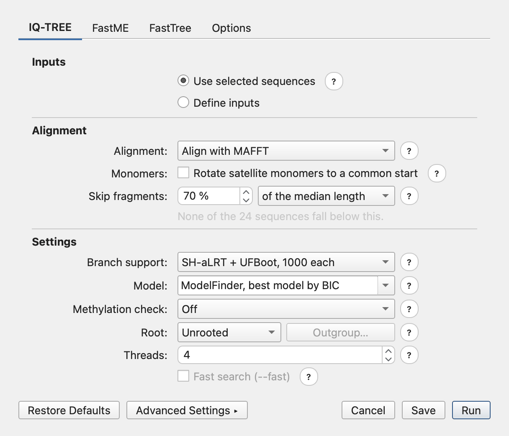
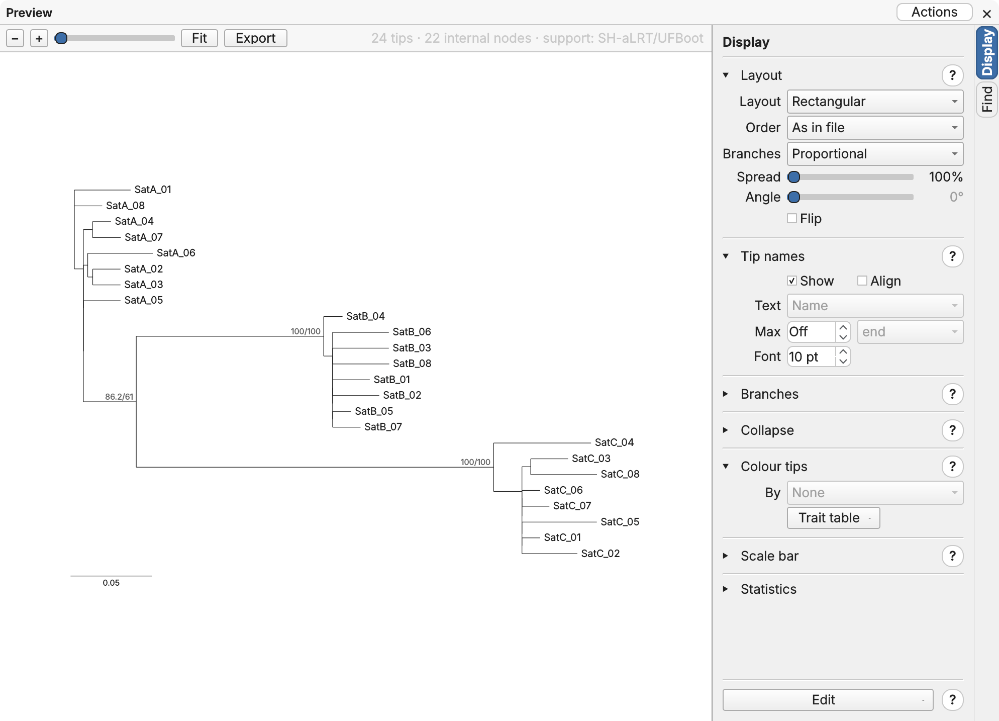
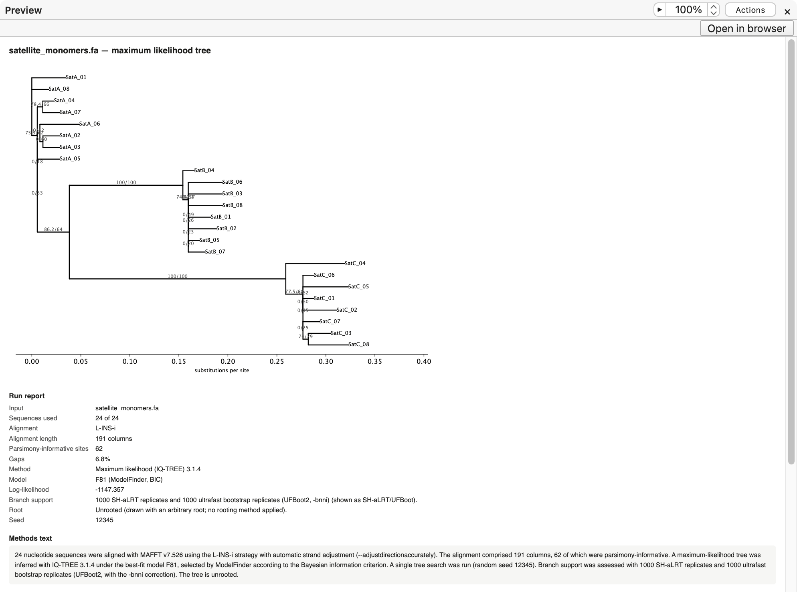

# Trees

## Building a tree

**Tools → Tree** (add the **Tree** button in **File → Setting → Toolbar**)

Builds a phylogenetic tree from the selected FASTA files; several files are
combined into one tree. RepeatViewer prepares and checks the input and writes
the report; established programs do the computing:

- **MAFFT** (bundled) aligns input that is not yet aligned.
- **IQ-TREE 3** (bundled): maximum likelihood, the default.
- **FastME** (minimum evolution, with bootstrap) and **FastTree**
  (approximate maximum likelihood, for more than about 1,000 sequences): install
  them yourself (see [Installation](02-installation.md#optional-external-programs)).

If the chosen program is missing, the run stops with an install hint; it never
falls back silently to a weaker method.

**Tools → Tree** opens the window. It has a tab per program (**IQ-TREE**,
**FastME**, **FastTree**) and **Options**.

| Section | Setting | Default | Why |
|---------|---------|---------|-----|
| Alignment | Alignment | Align with MAFFT | Input whose sequences all have the same length is used as an alignment as it is |
| | Monomers: rotate satellite monomers to a common start | off | Satellite monomers cut from arrays start at different points of the repeat; rotating them first avoids false differences |
| | Skip fragments | 70 % of the median length | Shorter sequences (often 5′-truncated copies) are left out, listed in the report and saved to `.excluded.fa`. A grey line says how many. Use "of the longest" for monomers |
| Settings | Branch support | SH-aLRT + UFBoot, 1000 each | Shown as SH-aLRT/UFBoot; commonly trusted at 80 / 95 and above |
| | Model | ModelFinder, best by BIC | The chosen model is named in the report |
| | Methylation check | Off | Also build a tree without CG (or CG and CHG) positions and compare (see below) |
| | Root | Unrooted | Or an **Outgroup…** (tick one or more sequences), or midpoint |
| | Threads | Settings value | IQ-TREE picks the best number up to this |
| | Fast search (`--fast`) | off | Quicker IQ-TREE search, for large sets |
| Advanced | MAFFT strategy, adjust direction, `--op` / `--ep`, independent searches (5), random seed (12345) | | Several IQ-TREE searches are run and the best kept; the report says how many found the same tree. The seed is recorded so the run can be repeated exactly |

The **?** buttons next to the strategy, method and model explain the choices.
Options that do not apply are greyed out.

### Input checks

- Copies from the other strand are turned around before aligning (**adjust
  direction**), so they do not look extremely divergent.
- Pairs of sequences that share almost no aligned positions stop distance
  methods; other problems give warnings. If the median difference between
  sequences is 50 % or more, the report asks whether the input is related at
  all.

### Methylation check

In plant repeats, cytosines in CG and CHG context are often methylated and
mutate to T much faster than other positions. Such changes can group sequences
by methylation history instead of descent. With **Methylation check** on,
RepeatViewer also builds a tree without those positions (`_masked.treefile`),
compares the two trees (normalised Robinson–Foulds distance) and lists the
well-supported groups that change.

### What is written

Like every tool, only the main result goes next to the input:

| File | Contents |
|------|----------|
| `<input>_iqtree.treefile` | The tree (Newick with support values), for FigTree, iTOL or ggtree. Opens in the tree viewer |
| `<input>_iqtree_details/` | Report (`_report.html`), alignment (`.aln.fa`), IQ-TREE report and log, names table (`.names.tsv`: tree names and original FASTA headers), methods paragraph with references (`_methods.txt`), program versions and command lines (`_commands.txt`) |

The engine is part of the name (`_iqtree`, `_fastme`, `_fasttree`); rotated or
methylation-checked runs add `_rot`, `_cg` or `_cgchg`. A second run writes
`_2`. If a run fails, nothing half-finished is left and the full log is saved
as `<input>_iqtree_failed.log`, ready to send with a bug report.

## The tree viewer

A tree file (`.treefile`, `.nwk`, `.newick`, `.tree`) opens in the tree viewer.
After a run the new tree opens there.

The bar above the tree has − / + and slider (zoom), **Fit** and **Export**
(figure as SVG, PDF or PNG). Shift + scroll zooms; double-click empty space
fits.

### Display panel

| Section | Settings |
|---------|----------|
| Layout | **Layout** (rectangular, circular, radial…), **Order** (as in file, or ladderized), **Branches** (proportional, equal, square root: changes only the drawing), **Spread** (space between tips), **Angle** (rotation of circular and radial trees), **Flip** |
| Tip names | **Show**, **Align** (all names on one line, with dotted leaders), **Text** (name, or name plus a trait), **Max** length (shorten long names from the end or the start), **Font** |
| Branches | Support or length labels, digits, font, line weight, **Hide crowded** labels, **Hide zeros** |
| Collapse | Collapse clades with low support, or whose tips are closer than a distance (display only) |
| Colour tips | **By** a trait column; **Trait table** (create, reload, open in a spreadsheet app) |
| Scale bar | Show, length, font |
| Statistics | Tips, internal nodes, tree depth; **Open run report** |

All view settings are saved with the tree (in a hidden `.view.json` next to it)
and used in exported figures.

### Trait table

Tips can be coloured by any property: chromosome, array, subfamily,
methylation level, FISH signal. **Colour tips → Trait table → Create or
update…** writes `<tree>_traits.tsv` next to the tree (first column `name`).
For trees built by RepeatViewer it is filled from the FASTA headers:
`chromosome`, `start`, `end`, `strand`, `array` (copies closer than 10 kb), and
optionally `methylation` from a Bismark `.cov` or modkit bedMethyl file. Add
your own columns in a spreadsheet; they are kept when the table is updated.

### Editing

Click a branch to select a clade, or drag over tip names (⌘ adds to the
selection). **Edit** (bottom of the panel), and right-click on the tree, offer:

- **Reroot on this clade**, **Midpoint root**: support values stay on their
  branches.
- **Swap branches**, **Collapse clade** / **Expand clade**, **Show only this
  clade**, **Back to full tree**, **Expand all**.
- **Colour clade…**, **Remove colour**, **Remove all colours**.
- **Extract sequences** of a clade (without gaps, or as aligned).
- **Show in alignment** (also a double-click on a tip): opens the alignment the
  tree was built from at that sequence.
- **Copy name**, **Copy original header**.
- **Save tree (.treefile)**, **Distance matrix…** (patristic distances from the
  tree, or p-distances from the alignment; copy or save as TSV), **Copy
  Newick**.
- **Undo** / **Redo** (**⌘Z** / **⇧⌘Z**).

The **Find** tab searches tip names and trait values and selects the hits.

### The report

The run report (`_report.html` in the details folder; **Statistics → Open run
report**) shows the tree, the input and alignment numbers, the model, support
and rooting, warnings, a methods paragraph you can paste into a paper, and the
references to cite.
