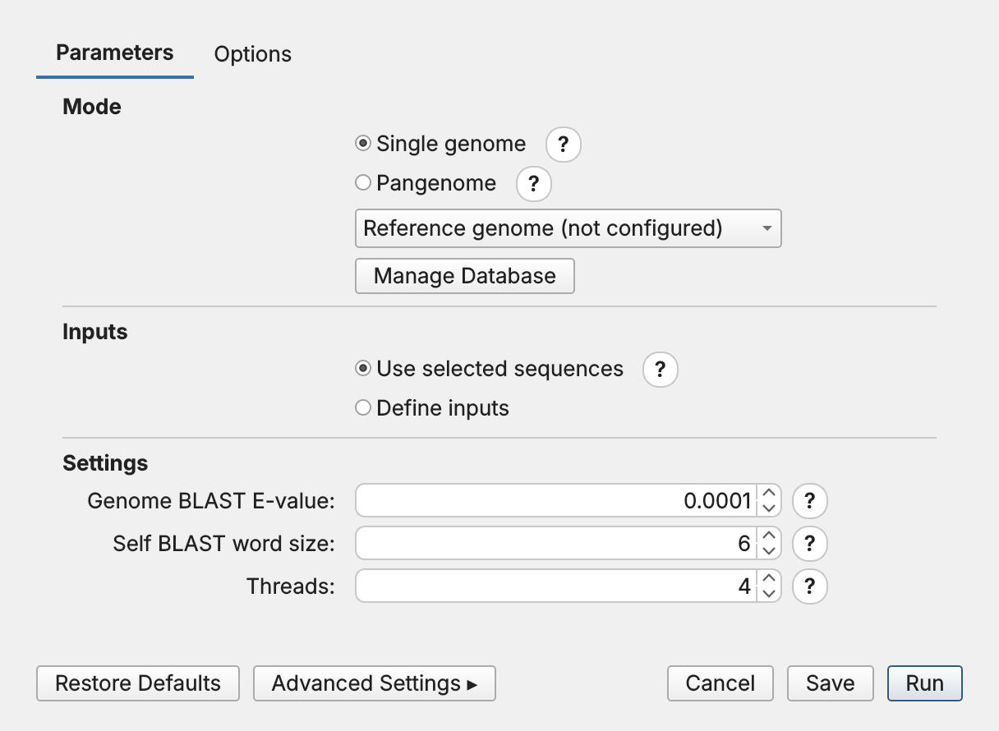
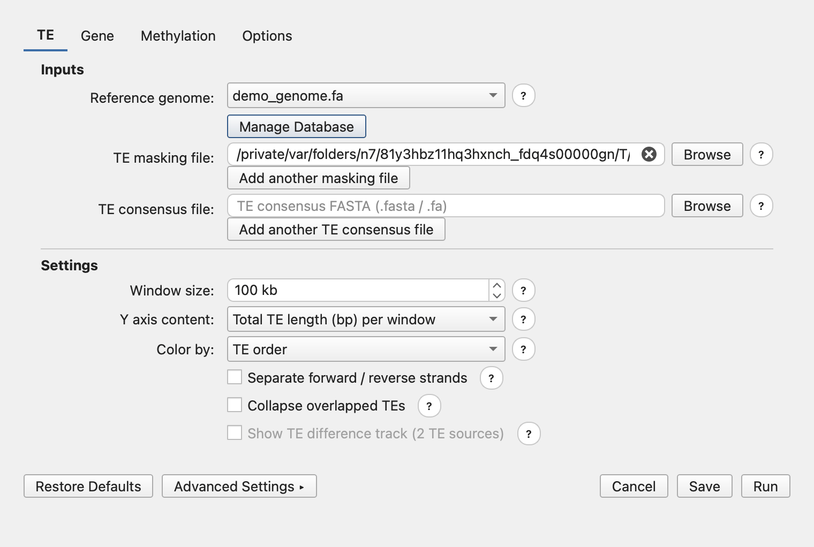
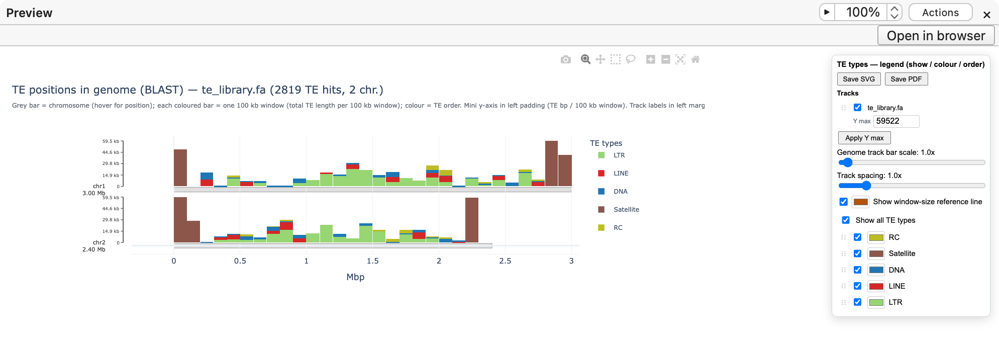
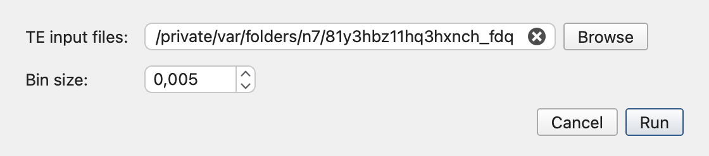
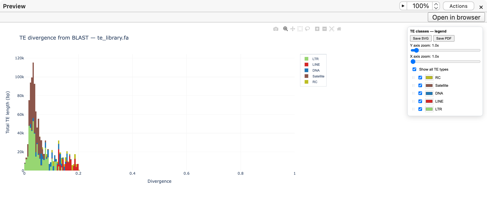
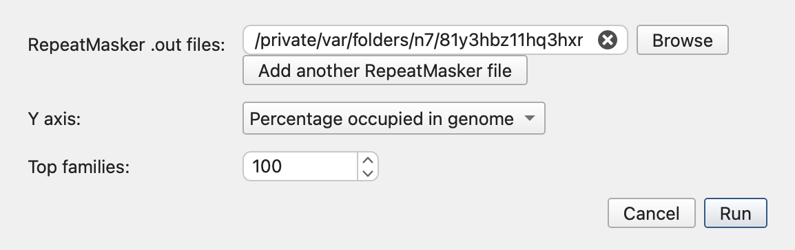
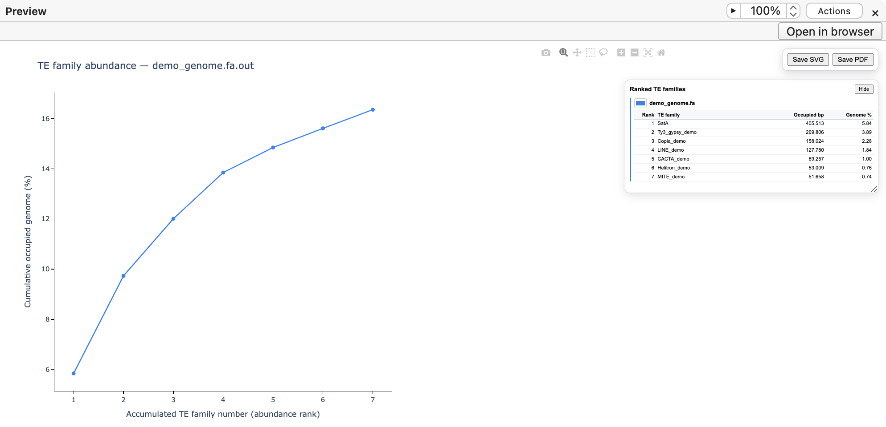

# Repeat analysis

## TE-Aid

**Toolbar: TE-Aid · Tools → Curate → TE-Aid**

Makes an interactive HTML report for one consensus sequence, in the style of
[TE-Aid](https://github.com/clemgoub/TE-Aid): its copies in the genome and how
much of the consensus each covers, the coverage of the consensus by genomic
hits, a self-dotplot, and the terminal repeats and ORFs. It is the clearest
single view of whether a consensus is finished.

| Section | Setting | Default | Meaning |
|---------|---------|---------|---------|
| Mode | Single genome / Pangenome | Single genome | Search one genome, or every genome of a pangenome |
| | Genome | reference genome | Or a saved BLAST database |
| Settings | Genome BLAST E-value | 0.0001 | Threshold for finding copies |
| | Self BLAST word size | 6 | Seed length for the self comparison |
| | Threads | | For both BLAST runs |
| Advanced | Line transparency | | Opacity of the hit lines |
| | Full-/mid-length hits | | Colour hits by length relative to the consensus |

**Output:** `<name>_TEAid.html` (one genome) or `<name>_pTEAid.html`
(pangenome), shown in Preview.

## Dotplot

**Toolbar: Dotplot · Tools → Visualize → Dotplot**

Compares sequences with themselves or with each other. The window has two
engines.

**Built-in** (fast, interactive):

| Setting | Default | Meaning |
|---------|---------|---------|
| Mode | Self comparison | **Self**: each file against itself (`<name>_self_dot.paf`). **Pairwise**: every sequence against every other (`<first>_multi_dot.paf`); with three or more sequences the self comparisons fill the diagonal |
| Word size | 15 | Length of exact matches. Larger is faster and less sensitive |
| Include reverse-complement matches | on | Show inverted repeats (TIRs) as well |

The result opens in the dotplot view, the same as the **Dotplot (Self)** tab of
a sequence.

**Flexidot** writes publication-style dotplots with
[Flexidot](https://github.com/molbio-dresden/flexidot), and shades the
annotations:

| Setting | Meaning |
|---------|---------|
| Mode | One plot for all files, or one per file |
| Output format (`-f`) | HTML (interactive) or an image |
| k-mer (`-k`), sequence type (`-t`) | Word length; DNA or protein |
| Show GFF features (`-g`) | Shade the annotations |
| Advanced: `-S`, `--max_n`, `-A` | Mismatches allowed in a word, maximum N content, line width |

With HTML output, clicking a region in the dotplot jumps the Overview of that
sequence to the same position (this needs the RepeatViewer build of Flexidot,
installed with RepeatViewer).

**Outputs:** `<name>_flexidot.html`, `<name>_flexidot.gff`,
`<name>_flexidot_legend.png`.

## Repeat Quantify

**Tools → Quantify → Repeat Quantify**

Measures how much of a genome a library of monomers, satellites or TEs
accounts for: copy numbers, arrays, genome fraction and divergence. Aimed at
tandem repeats, where "how many copies, in how many arrays, and how much of the
genome" is the question.

**Inputs**: the **Library** (the monomer or consensus FASTA) and the
**Genome**. **Add another genome** runs the same library against several
genomes, one report each. Click files in the Files panel to fill the fields.

**Engines**, one per tab: **BLASTn** (fast, bundled), **RepeatMasker**
(installed separately; also gives a divergence landscape), or **Both**, side by
side.

| Setting | Default | Meaning |
|---------|---------|---------|
| -word_size (BLASTn) | 11 | 7 can make BLAST hang on large genomes |
| -evalue (BLASTn) | 0.0001 | |
| -div (RepeatMasker) | 40 % | Most divergence counted |
| Sensitivity (RepeatMasker) | Sensitive (`-s`) | RepeatMasker speed preset |
| Advanced: minimum identity, minimum coverage | 0 = none | `-perc_identity` and `-qcov_hsp_perc` |

**Output**: a new folder for each run, by default next to the genome:
`<genome>_repeat_quant_<date>_<time>/`, with an HTML report and TSV and GFF
tables. The report has one row per family:

| Column | Meaning |
|--------|---------|
| monomer_len | Length of the library sequence (the period), bp |
| copy_number | covered_bp ÷ monomer length (a fraction when less than one monomer is covered) |
| hits | Number of alignment pieces |
| arrays | Hits merged into continuous blocks (about the number of array loci) |
| covered_bp | Genome bp covered, overlaps counted once |
| %target | covered_bp as a percentage of the genome |
| mean_array_bp, max_array_bp | Mean and longest array |
| mean_identity | Length-weighted mean identity to the library sequence (high = young or conserved) |
| mean_divergence | RepeatMasker Kimura divergence (high = old) |
| scaffolds | Number of genome sequences hit |

If a family name appears twice in the library, the report warns you: their hits
are merged into one row. Give every record a unique name. The genome BLAST
index is kept between runs; **File → Setting → General → Diagnostics → Clear
cache** removes it.

## Genome plots: TE density, divergence and abundance

**Toolbar: Visualization · Tools → Visualize**

Three interactive plots of repeats in a genome: where they sit along the
chromosomes (**TE density plot**), how old they are (**TE divergence plot**),
and which families dominate (**TE abundance plot**). The density plot needs a
reference genome (see [Manage Database](07-search.md#manage-database)). The
windows stay open while you click files in the Files panel to fill their
fields. The plots open in Preview; **Open in browser** shows them full size,
and the panel on the right of each plot saves it as SVG or PDF.

The inputs are a BLAST hit table of your TE library against the genome
(`<library>_bn.txt`, from [BLAST](07-search.md#blast)) or a RepeatMasker `.out`
file. Library names in the form `name#class/family` (for example
`Ty3_gypsy_demo#LTR/Gypsy`) let the plots group hits by class.

### TE density plot (Genome density plot)

**Tools → Visualize → Genome density plot**, or click **Visualization** on the
toolbar.

Shows where repeats sit along the chromosomes, as stacked bars per window.

The window has a tab per kind of track (**TE**, **Gene**, **Methylation**) and
**Options**:

| Tab | Input | Accepts |
|-----|-------|---------|
| TE | Reference genome | The project genome, or another FASTA DNA from Manage Database |
| | TE masking file | RepeatMasker `.out` or a BLAST hit table (`_bn.txt`) |
| | TE consensus file | The library FASTA (optional: lengths and classes of the families) |
| Gene | Annotation file | GFF, GTF, BED or VCF (genes, for example) |
| Methylation | Methylation file | Bismark `.cov` or modkit bedMethyl |

**Add another …** under each field adds more sources; tracks are drawn in
field order, the first at the top.

| Setting | Default | Meaning |
|---------|---------|---------|
| Window size | 100 kb | Width of each bar along the chromosome |
| Y axis content | Total TE length (bp) per window | What the bar height shows |
| Color by | TE order | Colour the bars by order, superfamily or family |
| Separate forward / reverse strands | off | One track per strand |
| Collapse overlapped TEs | off | Count overlapping hits once |
| Show TE difference track | off | With two TE sources: a track of where they differ |
| Advanced, Options | | Which annotation features to draw, minimum methylation coverage, chromosome order, which chromosomes to show, plot all track types together |

In the plot, hover a bar for its numbers, drag to zoom into a region (the
region can be saved as its own plot), and use the side panel to switch TE
classes on and off, change the scale and save the figure.

**Output:** `<name>_bn_den_plot.html` (named after the source: `bn`, `RM`, …),
`<name>_multi_dens_plot.html` for several sources, and `…_region.html` for a
zoomed region.

### TE divergence plot

**Tools → Visualize → TE divergence plot**

The age profile of the repeats: a histogram of divergence from the consensus
(1 − identity), stacked by class. A sharp peak at low divergence means a recent
burst; a broad distribution means long, older activity.

| Setting | Meaning |
|---------|---------|
| TE input files | BLAST hit tables or RepeatMasker `.out` files |
| Bin size | Width of each histogram bar (0.005 = 0.5 % divergence) |

**Output:** `<name>_bn_div_plot.html`, or `<name>_multi_div_plot.html` for
several sources.

### TE abundance plot

**Tools → Visualize → TE abundance plot**

Which families dominate a genome: families ranked by the genome share they
occupy, as a cumulative curve, one curve per RepeatMasker `.out` file. The
table beside the plot lists the families with the bp and percent of the genome
they occupy.

| Setting | Meaning |
|---------|---------|
| RepeatMasker .out files | One or more; each becomes a curve |
| Y axis | Percentage occupied in genome, or occupied bp |
| Top families | How many families to show, ranked by occupied bp |

**Output:** `<name>_RM_abund_plot.html`, or `<name>_multi_abund_plot.html` for
several sources.
