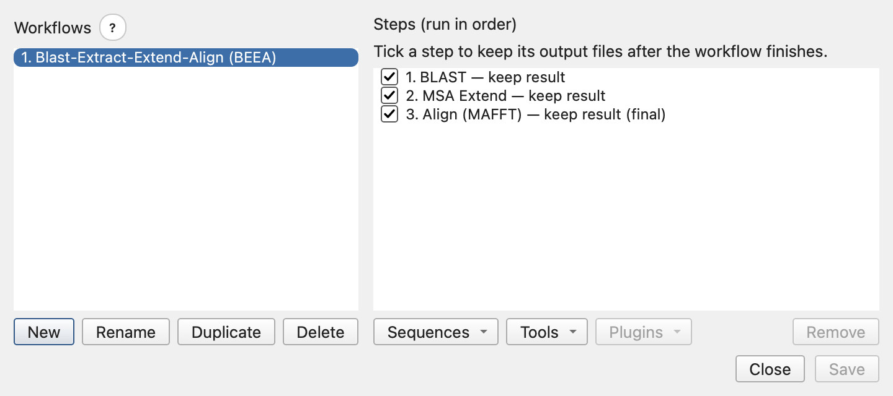
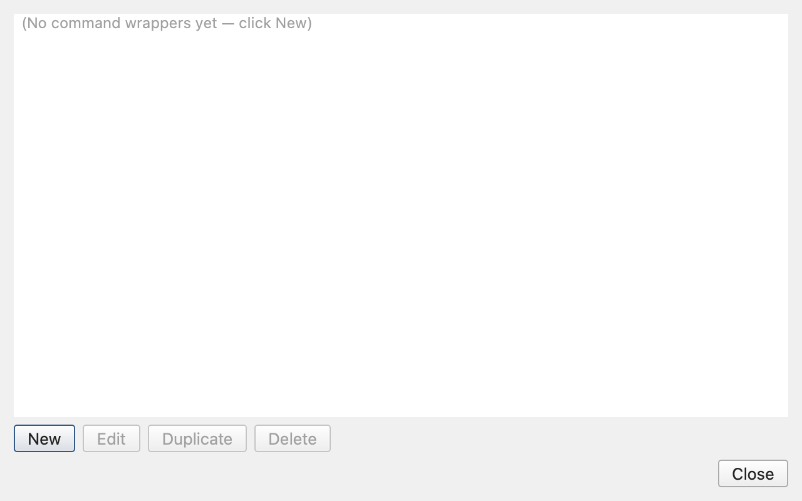

# Automation

## Workflows

**Workflows → Design and manage your workflows**

A workflow chains tools so that a multi-step pass runs as one action. If you
always follow BLAST with MSA Extend and Align, make it a workflow and run it on
many files at once. Each step uses that tool's saved settings, so set the
parameters in the tool's own window first.



- The list on the left holds your workflows. **New**, **Rename**,
  **Duplicate** and **Delete** manage them. **Blast-Extract-Extend-Align
  (BEEA)** is built in.
- The right side lists the steps in the order they run. Add steps from the
  **Sequences**, **Tools** and **Plugins** menus; **Remove** deletes the
  selected step.
- Tick a step to keep its output files after the workflow finishes; unticked
  intermediate files are removed. The last step's result is always kept.
- **Save** stores the workflow. It then appears in the **Workflows** menu: select
  files and choose it to run.

Steps only connect when the output of one fits the input of the next (for
example, BLAST makes FASTA that Align takes). Tools that make reports or plots
(TE-Aid, Dotplot) end a workflow. Steps that need the genome do not run until a
reference genome is set.

## Plugins

**Tools → Plugin (Beta) → Manage plugin**

Plugins add tools written in Python that use the same file selection, progress
bar and output highlighting as the built-in ones. A plugin receives the
selected files and the project (genome, databases, thread count) and returns
the files it made.

**Add** installs a plugin package: a folder with a `pyproject.toml`, or a
`.whl` file. Installed plugins appear under **Tools → Plugin (Beta)** and can be
put on the toolbar.

See [PLUGINS.md](../PLUGINS.md) for the programming interface and
[PLUGINS_TE_BENCHMARK.md](../PLUGINS_TE_BENCHMARK.md) for a worked example;
example plugins are in the repository's `examples/` folder.

## Command wrappers

**Tools → Command wrapper → Manage wrapper**

A command wrapper turns any command line you use often into a RepeatViewer
tool, without writing code. Click **New**, give the wrapper a unique name, an
optional tooltip, and the command, using these placeholders:

| Placeholder | Filled with |
|-------------|-------------|
| `${RV_INPUT}` | Full path of the first selected file |
| `${RV_INPUTS}` | Full paths of all selected files, separated by spaces |
| `${RV_GENOME}` | Full path of the reference genome (empty if none) |
| `${RV_FOLDER}` | The folder shown in the Files panel |
| `${RV_OUTDIR}` | Where to write: the folder of the selected file |
| `${RV_STEM}` | File name without its last extension (`TE123.fasta` → `TE123`) |
| `${RV_NAME}` | File name with its extension |

Example:

```
blastn -query ${RV_INPUT} -db ${RV_GENOME} -out ${RV_OUTDIR}/${RV_STEM}_b.txt -evalue 1e-5 -outfmt 6
```

You can also define your own variables (shown as fields when the wrapper
runs) and declare which output files the command makes, so they are
highlighted and opened like the outputs of built-in tools. Wrappers appear
under **Tools → Command wrapper** and can go on the toolbar.



## Command line

```bash
repeatviewer [-i FOLDER] [-g GENOME.fa]
```

| Option | Meaning |
|--------|---------|
| `-i`, `--input-dir` | Folder to open at start |
| `-g`, `--genome` | Reference genome FASTA |
| `--version` | Print the version and quit |

From a source folder, `python RepeatViewer.py` works too. Folders, layout,
genome and settings are remembered between sessions, so the options are for
scripted or repeated launches.
