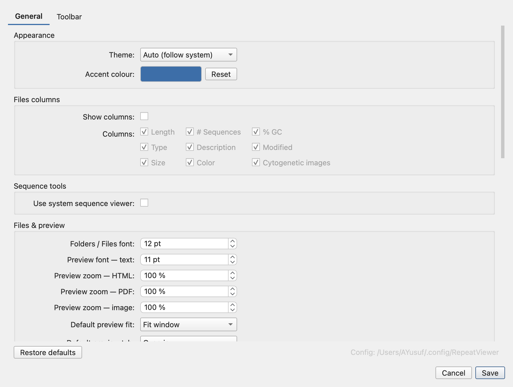
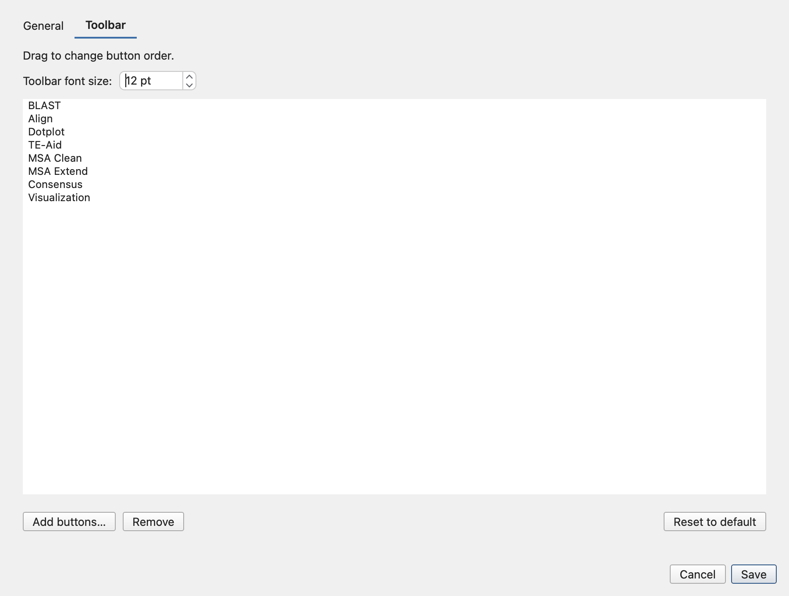

# Settings

**File → Setting** (**⌘,** on macOS) has two tabs: **General** and
**Toolbar**. **Save** applies the changes; **Restore defaults** resets the tab.
The path of the settings folder is shown at the bottom of the window.

## General

| Section | Setting | What it does |
|---------|---------|--------------|
| Appearance | Theme | Auto (follows the system), Light or Dark |
| | Accent colour | The colour of selections and highlights |
| Files columns | Show columns | Off: the Files panel shows only names. On: also the columns ticked below |
| | Columns | Length, number of sequences, GC %, type, description, modified, size, colour, cytogenetic images |
| Sequence tools | Use system sequence viewer | Open alignments in an external viewer such as AliView, and where it is |
| Files & preview | Folders / Files font | Font size in the Folders and Files panels |
| | Preview font: text | Font size of the Text view |
| | Preview zoom: HTML, PDF, image | Default zoom for reports, PDFs and images |
| | Default preview fit | Fit window, fit width, or original size |
| | Default preview tab | Which view a FASTA opens in: Text, Overview or Dotplot (Self) |
| | Show length and GC% in the preview | Off makes large genome FASTA files open faster, because GC % needs every base |
| Performance | Threads for the UI | Threads kept free so the window stays responsive; tools use the rest |
| | Max. parallel jobs | How many tool runs (or selected files) run at the same time |
| Startup | Reopen last folder | Open the last folder and genome at start |
| | Restore window size | Restore the window size and position |
| | Splash screen | Show the start-up banner with tips |
| External tools | Conda env name or path | The conda environment (on Windows: the WSL2 environment) with RepeatMasker, FastGA, HISAT2 and other external programs. **Test** shows which are found |
| BLAST databases | Base folder | Where new BLAST indexes are written. **Manage Database** opens the database window |
| Cytogenetic images | Experimenter | Your name, stored with images you attach |
| Diagnostics | Verbose logging | Write detailed messages to the log file |
| | Open log file, Open config folder | Show the log and settings files |
| | Copy diagnostics | Copy the version, system and folder locations to the clipboard, for a bug report |
| | Clear cache | Delete cached data (such as BLAST indexes kept by Repeat Quantify); shows how much space it uses |

## Toolbar

- Drag the entries to change the button order.
- **Toolbar font size** sets the size of the button labels.
- **Add buttons…** adds any tool from the File, Sequence and Tools menus (for
  example Mapping, Tree, Primers and Probes, NCBI Download, HMMER, AliView) or a
  separator; **Remove** takes the selected button off.
- **Reset to default** restores BLAST, Align, Dotplot, TE-Aid, MSA Clean, MSA
  Extend, Consensus and Visualization.

When the window is too narrow for all buttons, the rest move into a menu behind the
arrow at the right end of the toolbar.
